<p align="center">
  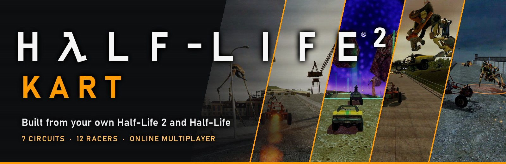
</p>

<p align="center">
  <b>A Mario Kart–style racer for Godot 4.7, built from your own copies of Half-Life 2 and Half-Life.</b><br>
  Seven long circuits with shortcuts · 12 racers · 6 vehicles · HL2 items · track hazards · drifting and boosts · LAN and internet multiplayer
</p>

<p align="center">
  
  
  
  
</p>

<p align="center">
  <a href="https://github.com/NVG-Games/hl2-kart/releases/latest"></a>
  <a href="https://github.com/NVG-Games/hl2-kart/releases"></a>
</p>

<p align="center"><a href="README.ru.md">Русская версия</a> · <a href="#new">What's new</a> · <a href="#play">How to play</a> · <a href="CONTRIBUTING.md">Contribute</a></p>

> **Free, non-commercial fan project, not affiliated with Valve.** This repository holds
> the code only. To play you need **Half-Life 2** and **Half-Life** on Steam: one script
> builds every model, texture, sound and track from them on your own computer.
> See [LEGAL.md](LEGAL.md).

<a id="new"></a>
## New in 0.3.0

<table>
  <tr>
    <td width="33%">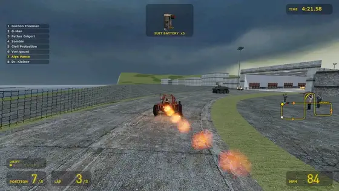</td>
    <td width="33%">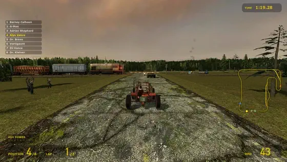</td>
    <td width="33%">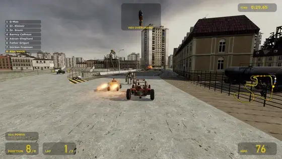</td>
  </tr>
  <tr>
    <td align="center" valign="top"><b>Nova Prospekt</b> (new): a Combine teleport bubble puts you back</td>
    <td align="center" valign="top"><b>White Forest</b> (new): the barrier is down, wait for the train</td>
    <td align="center" valign="top"><b>CT17 in ruins</b>: three striders hunt any kart</td>
  </tr>
  <tr>
    <td>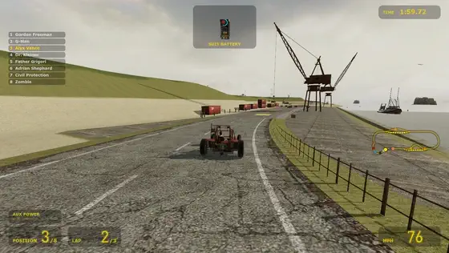</td>
    <td>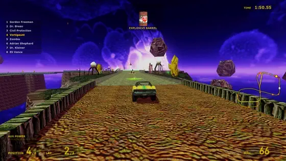</td>
    <td>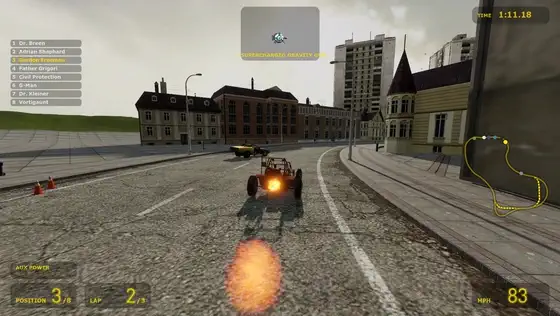</td>
  </tr>
  <tr>
    <td align="center" valign="top"><b>Highway 17 by the sea</b>: mind the dock crane's magnet</td>
    <td align="center" valign="top"><b>Xen comes alive</b>: bullsquids spit acid on the road</td>
    <td align="center" valign="top"><b>Supercharged gravity gun</b>: the karts in front go sky-high</td>
  </tr>
</table>

The first start after updating builds the content again, once. Online, everyone needs
0.3.0.

Two new tracks make seven. Highway 17 moved to the coast, CT17 is City 17 in ruins and
Xen's wildlife is awake. Falling off is different on every track now, with six kinds of
rescue: a scanner takes your photo, a rebel crane lifts you out with its magnet, vortigaunts
beam you back. The gravity gun pulls
the kart ahead back over you, Dog gallops with Half-Life 2's own animations and the bathtub
has two propane-tank thrusters. Every change is in [CHANGELOG.md](CHANGELOG.md#unreleased).

## The circuits

Every lap is 2.1 to 2.7 km, with two shortcuts off it, hazards along it and spectators
at the roadside. The road, walls, tunnels and bridges are built by the track tools, then
dressed with the games' own textures, models, skies, signs and music. Nova Prospekt and
White Forest are new in 0.3.0.

<table>
  <tr>
    <td width="50%">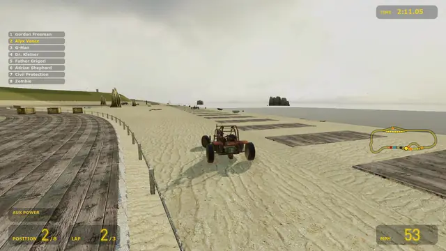</td>
    <td width="50%">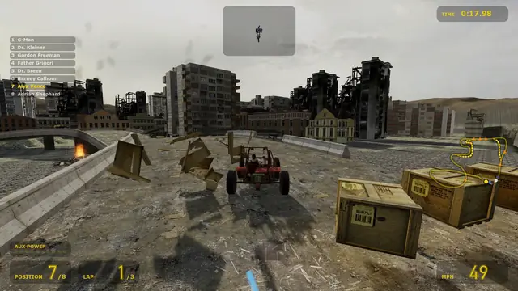</td>
  </tr>
  <tr>
    <td valign="top"><b>Highway 17</b>: Half-Life 2's coast, with a gunship over the bay bridge and a tunnel where the road runs over the ceiling.<br>
      <sub><b>Hazards:</b> gunship, magnet crane, antlions · <b>Shortcuts:</b> old bridge, stepping stones · <b>Rescue:</b> the rebels' magnet crane</sub>
      <details><summary>The full lap</summary>The coast of Half-Life 2's Highway 17 and Sandtraps: the highway on the cliffs over the sea, the long bay bridge over an inlet of the sea under a strafing gunship, a tunnel into the headland where the road rolls all the way round its bore, over the ceiling, a cliff road down to the docks and the rebels' magnet crane, a wooden bridge over the inlet's mouth and the antlion beach, where the boardwalk is the only safe road (run onto the sand and the antlions wake), then up the east cliff back to the highway. Wrecks and a burnt-out Combine APC line the highway, rebels cheer from their camp at the docks, a Combine thumper keeps the last of the beach quiet and a lighthouse stands on the east point. Come off the road and a rebel crane fishes you out with its magnet.<br><br><i>Shortcuts:</i> the <b>old bridge</b>, the old coast bridge straight across the inlet with its middle span fallen into the water (it takes speed; short of the far side you swim), and the <b>stepping stones</b>, boards laid straight along the shore with sand between every one (shorter than the boardwalk's swing round the dunes, but every gap is sand).</details>
    </td>
    <td valign="top"><b>CT17</b>: City 17 in ruins, a figure-8 through fires, rubble and a blown-out block, with three striders on the prowl.<br>
      <sub><b>Hazards:</b> three striders, a Combine train, floor turrets · <b>Shortcuts:</b> canal jump, rooftops · <b>Rescue:</b> a scanner takes your photo</sub>
      <details><summary>The full lap</summary>City 17 in ruins as a figure-8: the station plaza under the Breencasts, a cutting and an underpass, a broken viaduct over the canal whose collapsed span you drive down into and up out of, the rail yard with its jump and a Combine train at the level crossing, the canal corner, the checkpoint's floor turrets, the old-town hairpins, the flyover and the boulevard toward the Citadel: in through a hole blown in a block's facade and out the other side, up a ramp of rubble onto a collapsed building's roof and down its fallen floor slab. Fires burn and smoke rises among the rubble, burnt-out cars and gutted blocks, and three striders walk beside the road, firing their warp cannons and machine guns at whoever comes near.<br><br><i>Shortcuts:</i> the <b>canal jump</b> straight over the canal instead of round the corner (flat out; short of the far bank you swim), and the <b>rooftops</b>, the long way over the old town's roofs instead of its hairpins: a ramp spiralling up onto them, three jumps over alleys and down a fallen slab into the street (no boost needed; short of a roof you drop into the alley and try that jump again).</details>
    </td>
  </tr>
  <tr>
    <td>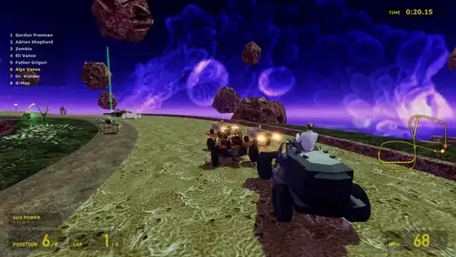</td>
    <td>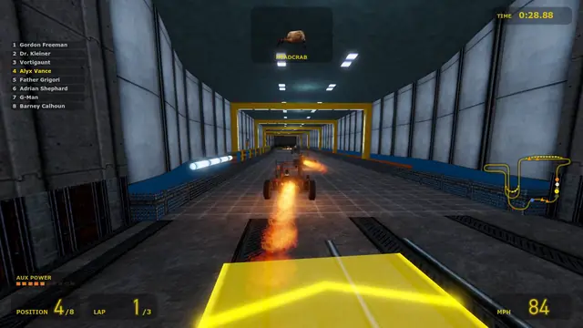</td>
  </tr>
  <tr>
    <td valign="top"><b>Xen</b>: floating islands over the void, low-gravity hops, bridges of living roots and locals who are wide awake.<br>
      <sub><b>Hazards:</b> controllers, houndeyes, bullsquids, alien slaves, a tentacle · <b>Shortcuts:</b> high root, island hop · <b>Rescue:</b> a Xen portal</sub>
      <details><summary>The full lap</summary>Floating islands over the void, as a figure-8: the start island with its healing pool, a root bridge, then bridges grown of living roots out to three small floating islands that you hop across in Xen's low gravity, floating over the void in long slow arcs, and back up to the plateau. Xen is alive: controllers float over the void beside the root bridge and the arch and throw slow orange energy balls at the road where you will be, packs of houndeyes pace the verges and run out to the road's edge to blast you, bullsquids at the island edges spit acid that leaves a glowing puddle on the road, alien slaves throw lightning on the crystal plateau. Then a chasm jump, a ledge with no railings down to an arch over the root bridge, and a tentacle by the long bridge home. The Nihilanth watches from afar.<br><br><i>Shortcuts:</i> the <b>high root</b>, a narrow root over the void with not even a rim, ending in a drop onto a deck, and the <b>island hop</b> across the bay over two floating rocks (two jumps that take speed).</details>
    </td>
    <td valign="top"><b>Black Mesa</b>: indoors through the Research Facility, twice across the reactor room, down the accelerator's beam line and over two slime pits.<br>
      <sub><b>Hazards:</b> laser tripmines, ceiling turrets, the Lambda core's discharges · <b>Shortcuts:</b> crane gantry, coolant jump · <b>Rescue:</b> a Black Mesa teleport</sub>
      <details><summary>The full lap</summary>Indoors through the Research Facility: the Sector C lobby, the high walk across the reactor room past the Lambda core's discharges, offices and labs with laser tripmines, the tram tunnel and the accelerator's service tunnel, flat and fast beside the beam line, its glowing beam pipe running through blue magnets under the yellow arches of the ring magnets, the storage hall with its slime-pit jump and ceiling turrets, waste processing with a second slime jump, and back round the core at coolant level, where the railing is torn out in places. The VOX announcer is on.<br><br><i>Shortcuts:</i> the <b>crane gantry</b> along the hall's wall above the pit and the turrets (any speed, a boost pad on it; you drop off its end back onto the road), and the <b>coolant jump</b> over the broken catwalk across the coolant pool (jump the gap or swim).</details>
    </td>
  </tr>
  <tr>
    <td>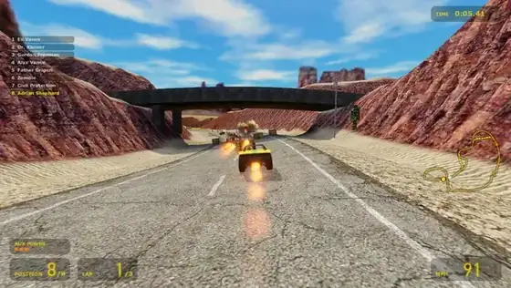</td>
    <td>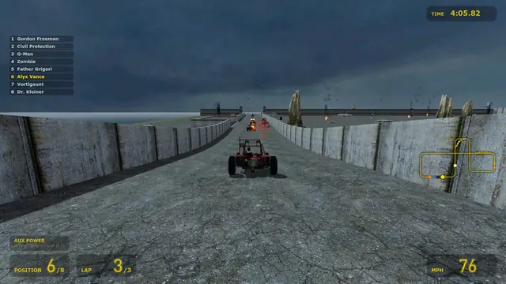</td>
  </tr>
  <tr>
    <td valign="top"><b>Surface Tension</b>: the desert outside Black Mesa, with an Apache, a red-rock canyon, the HECU camp and mortars on the dam.<br>
      <sub><b>Hazards:</b> Apache, sentry guns, mortars · <b>Shortcuts:</b> rim drop, washout · <b>Rescue:</b> a Black Mesa teleport</sub>
      <details><summary>The full lap</summary>The desert outside Black Mesa: an Apache over the start straight, a washed-out road to jump, a hairpin down into the red-rock canyon, the steel bridge over the river gorge, the HECU camp by a landed Osprey with its sentry guns and a jump, the dam's dry spillway, a concrete channel cut through the mountain with the dam's water main crossing over it, the cliff road with mostly nothing between you and the drop, mortars on the crest of the dam, and a viaduct back over the start straight.<br><br><i>Shortcuts:</i> the <b>rim drop</b>, a dirt road along the canyon's rim with no barrier that drops back onto the road at the hairpin's foot (it takes speed; short of it you land on the canyon floor), and the <b>washout</b>, a jump over the river from a broken causeway instead of the trip round by the gorge bridge (a boost pad on the run-up; short of it you swim).</details>
    </td>
    <td valign="top"><b>Nova Prospekt</b> <sup>NEW</sup>: the Combine prison on its sea cliff, on two storeys, with an antlion guard waiting in the collapsed yard.<br>
      <sub><b>Hazards:</b> the antlion guard, floor turrets · <b>Shortcuts:</b> upper tier, ventilation duct · <b>Rescue:</b> a Combine teleport</sub>
      <details><summary>The full lap</summary>The Combine prison on its sea cliff, on two storeys: from the entry yard under a high walkway, through the gatehouse into cell block A's tall ground floor, the tiled canteen and a long ramp up onto the upper level, the walkways over both yards and round the depot's roof, and the gallery of a ruined cell block whose floor fell into the antlion caves. Down into the collapsed yard, where the antlion guard bursts up through the floor and charges: if it catches you it shoves you into the hole where the floor gave way, and you drop into Episode Two's antlion caves, lit by glowing grubs. Drive out yourself, up a rock cutting onto the cliff road, and you come out about level with the others, with a long boost and, if you hold no item, one of the strongest items over them. Then out through the west gate along the cliff road between the outer wall and the fence, the sea far below, and back in through the laundry. Floor turrets guard the canteen and Combine prison guards watch from the yards and the roofs. Off the road, a Combine teleport puts you back.<br><br><i>Shortcuts:</i> the <b>upper tier</b>, the gallery along cell block A's wall, off the floor and up past the cells, dropping you back onto the floor at its end (a boost pad on it), and the <b>ventilation duct</b>, a narrow duct across the depot's roof that cuts its corner.</details>
    </td>
  </tr>
  <tr>
    <td>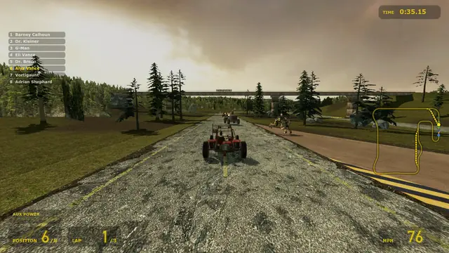</td>
    <td rowspan="2" align="center"><b>Your track here?</b><br>A circuit is one Python module in <code>tools/circuits/</code> and an entry in two lists. <a href="CONTRIBUTING.md">CONTRIBUTING.md</a> shows how.</td>
  </tr>
  <tr>
    <td valign="top"><b>White Forest</b> <sup>NEW</sup>: Episode Two's pine forest, with trains, a see-saw bridge and a Combine column firing from above.<br>
      <sub><b>Hazards:</b> the Combine column, the see-saw bridge, a freight train at the level crossing · <b>Shortcuts:</b> logging trail, sawmill shed · <b>Rescue:</b> vortigaunts</sub>
      <details><summary>The full lap</summary>Episode Two's forest on the way to the White Forest base: broken asphalt and logging roads through the pines. From the start beside the railway, where a freight train can race you along the fence, down into a rock cutting under the railway's girder bridge and out onto the gorge road and the see-saw bridge: a steel span on a pivot over the river gorge that tips toward whichever end the karts are on, so you climb it or ride it down. Round the east hill and down into the valley under the high bridge the Combine column marches across (where it halts over the road it paints red strips where karts will be and opens fire a moment later: change your line), round the hairpin at the valley's end and back under the bridge again, through a cutting in the ridge, along the river, through the sawmill's yard and over the mill bridge, then up the west bank and over the railway at the level crossing, where the barrier arms come down well before a short train comes through. Standing trains wait on the sidings with a derailed wagon beside one, the cars that fell with the old bridge lie in the river under the see-saw, and rebels and vortigaunts watch from the verges and their camp. Off the road, the vortigaunts pull you back with their green energy.<br><br><i>Shortcuts:</i> the <b>logging trail</b> through the pines, with a jump over a dry gully (short of the far side you drop into it), and the <b>sawmill shed</b>, straight through the long shed while the yard road swings round the log stacks.</details>
    </td>
  </tr>
</table>

## Racers and vehicles

<p align="center">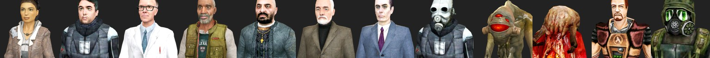</p>

Alyx, Barney, Kleiner, Eli, Father Grigori, Dr. Breen, the G-Man, a Metrocop, a
Vortigaunt and a Zombie from Half-Life 2, plus Gordon Freeman and Adrian Shephard
from Half-Life. Each one talks with their own lines from the games.

<p align="center">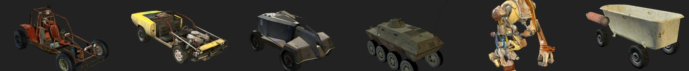</p>

The scout car, Gordon's muscle car from Episode Two, the Combine APC, a military APC,
Dog (carrying the racer on his shoulders) and a bathtub on wheels with two propane-tank
thrusters, Garry's Mod style, each with its own speed, acceleration, weight, handling and
engine sound.

## Features

- **Items** from HL2 supply crates, fourteen of them: a homing manhack, a rollermine, an
  explosive barrel, a HEV battery boost, the gravity gun (it pulls the kart ahead back over
  you), the Citadel's supercharged gravity gun (it blasts the karts in front sky-high), a
  headcrab canister strike on the leader, the HEV overcharge (seven seconds invulnerable,
  and whoever you touch goes flying), the AR2's energy ball (bounces off walls), watermelons
  to slip on, a hopper mine, Ravenholm's sawblade, headcrabs on the faces of the racers just
  ahead and a Xen teleport 140 m down the road. Batteries, manhacks and watermelons also
  come in threes.
- **Shortcuts:** two on every circuit. Chevron boards mark the forks, the HUD names a
  shortcut the first time you come up to it and the minimap draws them as dashes. Most
  end in a jump that takes speed or a boost; miss it and the rescue gives you one more
  try from the run-up when a standing start can still make it.
- **Track hazards:** turrets, striders, a Combine train, a gunship, a magnet crane,
  antlions under the sand, the antlion guard, laser tripmines, the Lambda core's
  discharges, controllers, houndeyes, bullsquids, alien slaves, a tentacle, an Apache,
  mortars, a freight train at a level crossing and a Combine column on a bridge. Each one
  warns before it strikes, a red chevron at the edge of the screen points at whatever has
  locked on you, and one run through a group of them costs at most one hit. TRACK HAZARDS
  in NEW RACE turns them off.
- **A rescue for every track:** drive into water or slime and you splash and sink; fall
  off, get wedged or end up behind a wall and help comes (R calls it). On CT17 a Combine
  scanner flies to you and takes your photo, on Highway 17 the rebels' crane lowers its
  magnet out of the sky and lifts you back, at Black Mesa and on Surface Tension a Black
  Mesa teleport builds up round you, on Xen a Xen portal swallows you, at Nova Prospekt a
  Combine teleport wraps you in a blue-white bubble, in White Forest vortigaunts pull you
  out with their green energy. In its flash you're back on the road. WRONG WAY flashes
  when you drive back along the road.
- **Spectators:** citizens, rebels, metrocops, scientists, guards, HECU marines and
  vortigaunts line the roads. They cheer the start and the finish, flinch at explosions,
  hop out of a kart's way, and some know your racer: metrocops condemn Gordon and salute
  Dr. Breen, the marines salute Shephard. Keep an eye out for the G-Man; a few more
  easter eggs are left to find. Fewer or none: Options > Video > Spectators.
- **Low gravity, a tube and open edges:** Xen's island hops float you over the void, the
  road in Highway 17's headland tunnel climbs the wall and runs over the ceiling, White
  Forest's see-saw bridge tips under the karts, and some bridges and cliff roads have no
  railings, so a wide line ends in a fall.
- **Drifting:** hold jump in a turn, let AUX POWER charge and release for a mini or
  super turbo. Hold the throttle on "one" for a rocket start.
- **Multiplayer:** LAN and internet, a Half-Life style server browser, a lobby with chat,
  bots for the empty grid slots, a dedicated server and a master server.
- **Source look and feel:** VertexLitGeneric / LightmappedGeneric style shaders, HL2 and
  HL1 skyboxes, `sv_gravity 600`, vehicle and surface properties read from the game
  scripts, HL2 and HL1 music. Dog, the antlions, the antlion guard, Xen's controllers,
  houndeyes and bullsquids, the Combine column's soldiers and White Forest's vortigaunts
  move with the games' own animations.

<table>
  <tr>
    <td width="33%">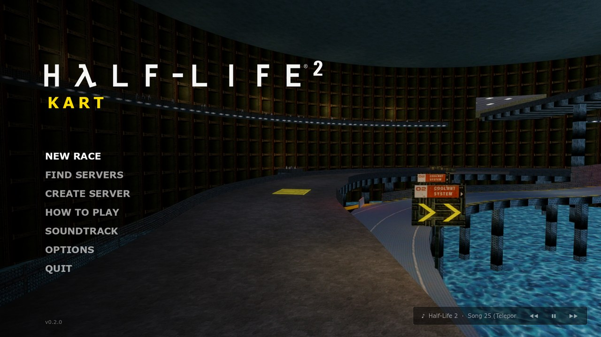</td>
    <td width="33%">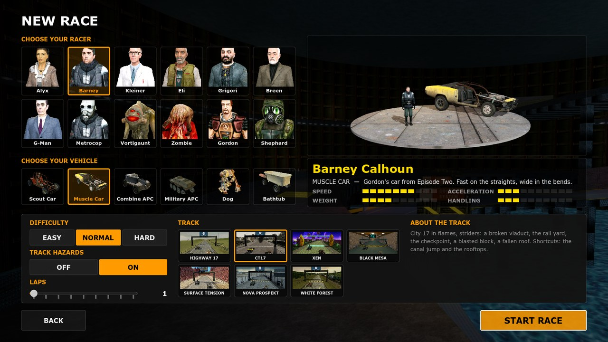</td>
    <td width="33%">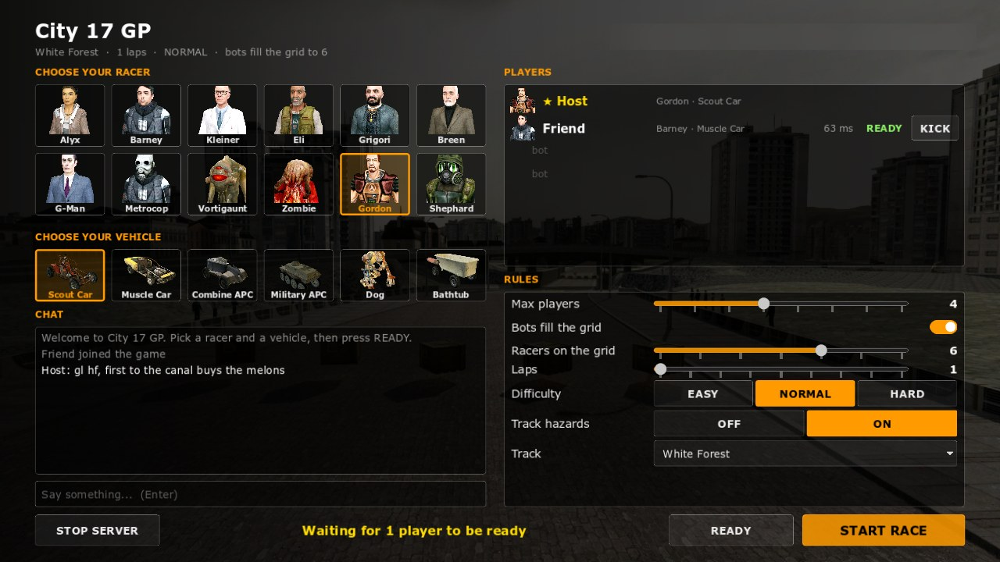</td>
  </tr>
  <tr>
    <td align="center">Main menu</td>
    <td align="center">New race</td>
    <td align="center">Online lobby</td>
  </tr>
</table>

<a id="play"></a>
## Play

1. Have **Half-Life 2** and **Half-Life** installed on Steam (Windows 10 or 11).
2. Download **HL2Kart-v…-windows.zip** from the [latest release](https://github.com/NVG-Games/hl2-kart/releases/latest)
   and unzip it anywhere.
3. Run **Play HL2 Kart.bat**.

The first start finds your two games and builds the game from them: 3 to 6 minutes and
about 2 GB. After that it starts straight into the menu. The download carries Godot and
a small Python, so there is nothing else to install, and nothing from Valve: the game's
content is made on your computer from your own copies. When a new version is out, the
main menu shows a download button. When an update changes the game content (new tracks,
spectators, hazards), its first start builds the content again the same way.

If Windows SmartScreen warns about an unknown app: *More info* → *Run anyway*.

### From source

For development, or to run the latest `dev` code:

- **Godot 4.7** (standard build: the free "Godot Engine" on Steam, or
  [godotengine.org](https://godotengine.org)) and **Python 3.10+** with `numpy` and `Pillow`.

```bash
git clone https://github.com/NVG-Games/hl2-kart.git
cd hl2-kart
pip install numpy pillow
godot --path .
```

The first start builds the content the same way (or run `python tools/setup_assets.py`;
`--only <step>` and `--from <step>` repeat or resume a step:
`extract, music, skies, tracks, import, ui`).

## Controls

| Action | Keyboard | Gamepad |
|---|---|---|
| Throttle | W / ↑ | A, right trigger |
| Brake / reverse | S / ↓ | X, left trigger |
| Steer | A / D, ← / → | left stick |
| Jump and drift | Shift / Space | RB |
| Use item | E / Ctrl / Enter | LB, B |
| Chat (online) | Y / T | |
| Look back | C | Y |
| Call for help | R | Back |
| Pause | Esc / P | Start |

## Multiplayer

The networking works like Source servers: UDP 27015 for the game, 27016 for the server
browser and LAN discovery, and optionally a master server on UDP 27010 for the INTERNET
tab.

- **Host:** CREATE SERVER, set the name, password, player limit, bots, laps, difficulty,
  track hazards and track. The host races too.
- **Join:** FIND SERVERS. On the same network the server shows up under LAN; over the
  internet type the host's address. Without UPnP on the host's router, forward UDP
  27015–27016 or play over a virtual LAN (Radmin VPN, ZeroTier, Tailscale).
- **Same version on every PC:** this build speaks network protocol 4. A server running
  another version shows as *(different version)* in FIND SERVERS and turns you away, so
  everyone updates together.
- **Lobby:** pick a nickname, racer and vehicle; the host changes the rules and starts.
  Track hazards ON or OFF is the host's rule and counts for everyone (the lobby line reads
  "hazards off" when they are off); spectators are each player's own option.
- **Racing:** the start, the countdown and the race clock follow the server, so times and
  results match on every screen. The server waits up to 45 s for a slow PC to load the
  race, then starts, and the late player joins it under way. A player who leaves
  mid-race is replaced by a bot.

Dedicated server (no window, srcds-like console; settings can also go in `server.cfg`,
see `server.cfg.example`):

```bash
godot --headless --path . -- --dedicated --name "City 17 GP" --max 8 --bots on --laps 3 --track xen
```

Track ids: `city17_circuit`, `ct17`, `black_mesa`, `xen`, `surface_tension`, `nova_prospekt`,
`white_forest`.
`--hazards off` (`mp_hazards 0` in `server.cfg`, `set mp_hazards 0` in the console) races
without the track hazards.
Console: `status`, `say <text>`, `kick <nick>`, `start`, `lobby`, `set <cvar> <value>`, `rules`, `quit`.

Master server for the INTERNET tab, on any machine with UDP 27010 open:

```bash
godot --headless --path . -- --master-server --port 27010
```

## Sharing it with friends

- Share the link to the [releases page](https://github.com/NVG-Games/hl2-kart/releases).
  Everyone downloads the zip and builds the content from their own Half-Life 2 and
  Half-Life on the first start, servers included.
- Re-sharing the official zip is fine. Do **not** share a folder after its first start,
  the `assets/` folder or any extracted files: that content belongs to Valve.
- Forks, mods and new tracks are welcome under the same non-commercial license.

## Contributing

Help is welcome: code, new tracks, testing, translations, ideas. Read
[CONTRIBUTING.md](CONTRIBUTING.md), pick an issue labelled `good first issue`, or open one
to discuss an idea. Work happens on the **`dev`** branch (the default); **`main`** only
moves for a release, and every release is listed in [CHANGELOG.md](CHANGELOG.md).

## For developers

- `scripts/`: the game (GDScript). `shaders/`: Source-style shaders.
- `tools/`: Python. VPK, MDL/VVD/VTX, GoldSrc MDL, VTF, VMT and WAD readers;
  `track_gen.py` builds the circuits from the definitions in `tools/circuits/` (a spline of
  styled stretches: street, open road, tunnel or hall, tube, bridge, cutting, jump), with their
  terrain, props, lights and signs (`build_track.py`, the first Highway 17's builder, is legacy).
  It takes the shortcuts through `branches.py`, the hazards through `hazards.py` and the
  spectators through `crowds.py`. `source_world.py` / `goldsrc_world.py` convert whole
  HL2 / HL1 maps if you want to experiment with real levels.
- `tests/`: headless AI races with stats (`race_stats.tscn`), photo tours, menu layout
  checks (`ui_fit.tscn`), shortcut, hazard and spectator checks (`branch_check.tscn`,
  `hazard_test.tscn`, `crowd_check.tscn`), network walkthroughs and a compile check of
  every script.

A new circuit is one Python module in `tools/circuits/` plus an entry in `TRACKS` in
`scripts/core/game.gd` and in `CIRCUITS` in `tools/setup_assets.py` (see
[CONTRIBUTING.md](CONTRIBUTING.md)). `tools/package_release.py` builds the Windows download; the
*Release build* workflow runs it and drafts the GitHub release when `version.json`
changes on `main`.

## License

The code is © NVG Games under the [PolyForm Noncommercial License 1.0.0](LICENSE.md):
free to use, change and share for any non-commercial purpose. Half-Life content is ©
Valve Corporation and is not included; see [LEGAL.md](LEGAL.md).
