<p align="center">
  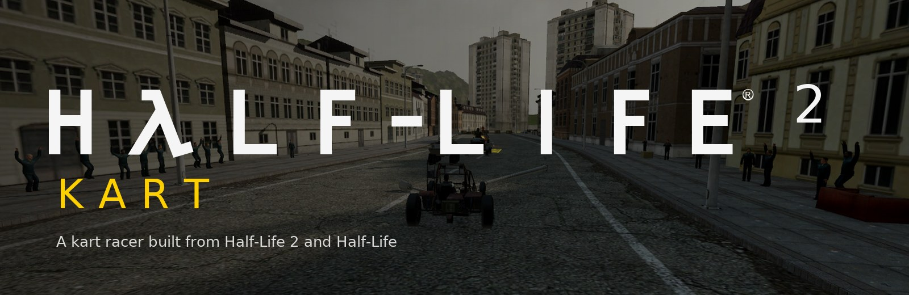
</p>

<p align="center">
  <b>A Mario Kart–style racer for Godot 4.7, built from your own copies of Half-Life 2 and Half-Life.</b><br>
  Five long circuits with shortcuts · 12 racers · 6 vehicles · HL2 items · track hazards · drifting and boosts · LAN and internet multiplayer
</p>

<p align="center">
  
  
  
  
</p>

<p align="center">
  <a href="https://github.com/NVG-Games/hl2-kart/releases/latest"></a>
  <a href="https://github.com/NVG-Games/hl2-kart/releases"></a>
</p>

<p align="center"><a href="README.ru.md">Русская версия</a> · <a href="#play">How to play</a> · <a href="CONTRIBUTING.md">Contribute</a></p>

> **Free, non-commercial fan project, not affiliated with Valve.** This repository holds
> the code only. To play you need **Half-Life 2** and **Half-Life** on Steam: one script
> builds every model, texture, sound and track from them on your own computer.
> See [LEGAL.md](LEGAL.md).

## New in 0.2.0

<table>
  <tr>
    <td width="33%">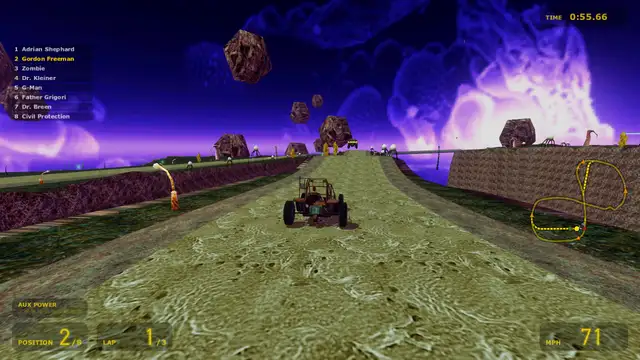</td>
    <td width="33%">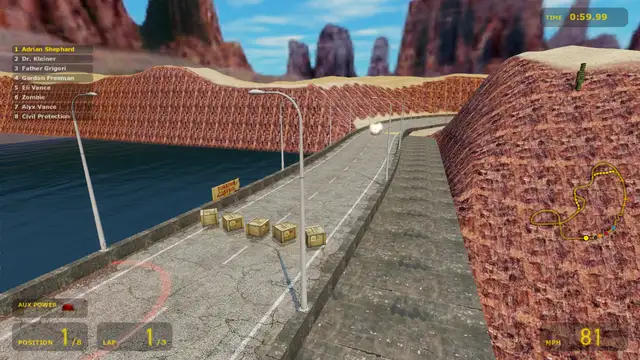</td>
    <td width="33%">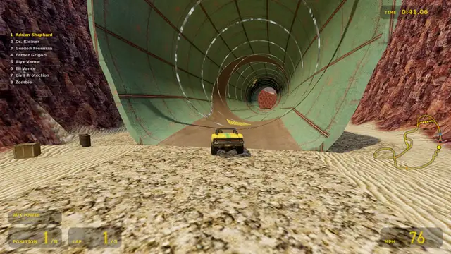</td>
  </tr>
  <tr>
    <td align="center"><b>Shortcuts</b>: two on every circuit</td>
    <td align="center"><b>Track hazards</b> that warn before they strike</td>
    <td align="center"><b>Tubes</b> that roll you round the pipe</td>
  </tr>
</table>

All five circuits are rebuilt, spectators line the roads, and seven new items are in the
crates. Every change is in [CHANGELOG.md](CHANGELOG.md).

## The circuits

Every lap is 2.1 to 2.5 km, with two shortcuts off it, hazards along it and spectators
at the roadside. The road, walls, tunnels and bridges are built by the track tools, then
dressed with the games' own textures, models, skies, signs and music.

<table>
  <tr>
    <td width="50%">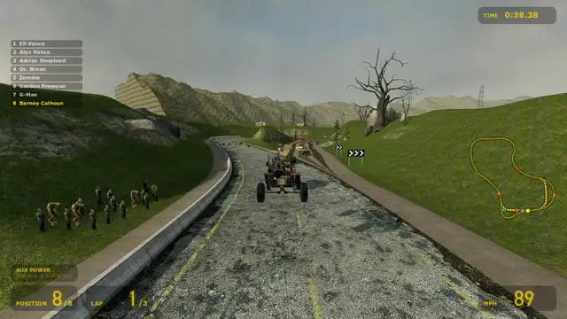</td>
    <td width="50%">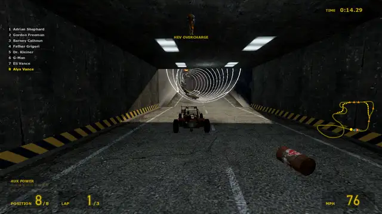</td>
  </tr>
  <tr>
    <td><b>Highway 17</b><br>Out of City 17 through the Combine checkpoint and its force-field gate, round the headland on the coast road under a strafing gunship, a jump over the inlet, out round a flooded quarry, through the hopper mines on the dirt road and back up the canal. Pick the weather.<br><i>Shortcuts:</i> the <b>headland trail</b>, a dirt track over two crests (any speed, a boost pad on it), and the <b>quarry jump</b> straight across the flooded pit (flat out, a boost pad on the run-up; fall in and the scanner puts you down past the gap).</td>
    <td><b>CT17</b><br>Combine-held City 17 as a figure-8: the station plaza under the Breencasts, a cutting and an underpass, a Combine pipe whose road climbs the wall nearly to the roof, the rail yard with its jump and a Combine train at the level crossing, the canal corner watched by a strider, the checkpoint's floor turrets, the old-town hairpins, the flyover and the boulevard toward the Citadel.<br><i>Shortcuts:</i> the <b>canal jump</b> straight over the canal instead of round the corner (flat out; short of the far bank you swim), and the <b>rooftops</b>, a ramp onto the old town's roofs and a jump over the street (it needs a suit battery or HEV boost; short of the far roof you land in the street below).</td>
  </tr>
  <tr>
    <td>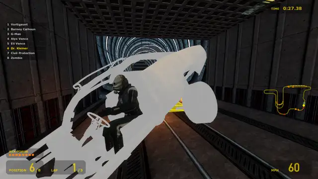</td>
    <td>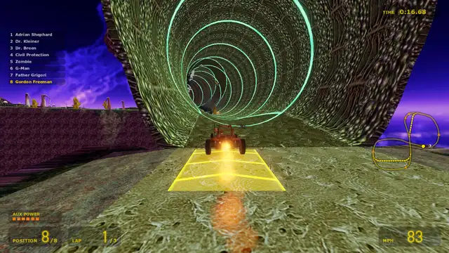</td>
  </tr>
  <tr>
    <td><b>Black Mesa</b><br>Indoors through the Research Facility: the Sector C lobby, the high walk across the reactor room past the Lambda core's discharges, offices and labs with laser tripmines, the tram tunnel and the accelerator tube that rolls you all the way round, the storage hall with its slime-pit jump and ceiling turrets, waste processing with a second slime jump, and back round the core at coolant level, where the railing is torn out in places. The VOX announcer is on.<br><i>Shortcuts:</i> the <b>crane gantry</b> along the hall's wall above the pit and the turrets (any speed, a boost pad on it; you drop off its end back onto the road), and the <b>coolant jump</b> over the broken catwalk across the coolant pool (jump the gap or swim).</td>
    <td><b>Xen</b><br>Floating islands over the void, as a figure-8: the start island with its healing pool, a root bridge, a living cave that rolls you all the way round, houndeyes on the islands, alien slaves throwing lightning on the crystal plateau, a chasm jump, a ledge with no railings down to an arch over the root bridge, and a tentacle by the long bridge home. The Nihilanth watches from afar.<br><i>Shortcuts:</i> the <b>high root</b>, a narrow root over the void with not even a rim, ending in a drop onto a deck, and the <b>island hop</b> across the bay over two floating rocks (two jumps that take speed).</td>
  </tr>
  <tr>
    <td>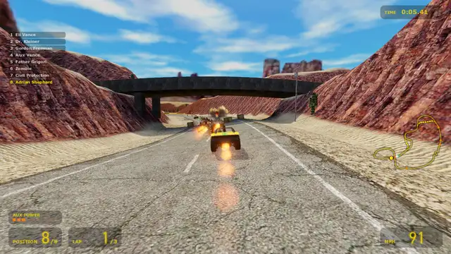</td>
    <td>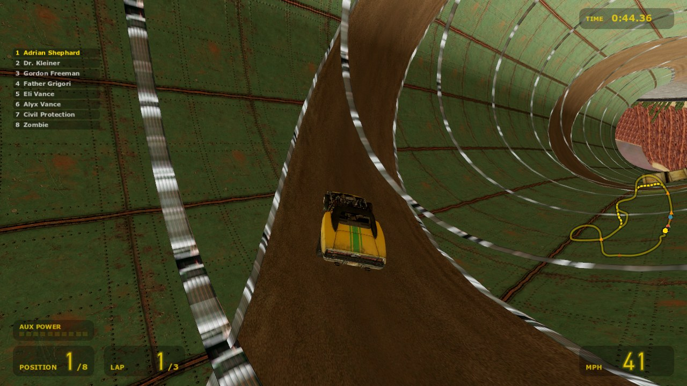</td>
  </tr>
  <tr>
    <td colspan="2"><b>Surface Tension</b><br>The desert outside Black Mesa: an Apache over the start straight, a washed-out road to jump, a hairpin down into the red-rock canyon, the steel bridge over the river gorge, the HECU camp by a landed Osprey with its sentry guns and a jump, the dam's water main that rolls you twice round the pipe, the cliff road with mostly nothing between you and the drop, mortars on the crest of the dam, and a viaduct back over the start straight.<br><i>Shortcuts:</i> the <b>rim drop</b>, a dirt road along the canyon's rim with no barrier that drops back onto the road at the hairpin's foot (it takes speed; short of it you land on the canyon floor), and the <b>washout</b>, a jump over the river from a broken causeway instead of the trip round by the gorge bridge (a boost pad on the run-up; short of it you swim).</td>
  </tr>
</table>

## Racers and vehicles

<p align="center">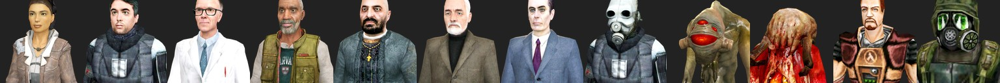</p>

Alyx, Barney, Kleiner, Eli, Father Grigori, Dr. Breen, the G-Man, a Metrocop, a
Vortigaunt and a Zombie from Half-Life 2, plus Gordon Freeman and Adrian Shephard
from Half-Life. Each one talks with their own lines from the games.

<p align="center">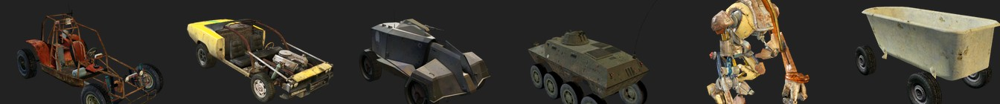</p>

The scout car, Gordon's muscle car from Episode Two, the Combine APC, a military APC,
Dog (carrying the racer on his shoulders) and a bathtub on wheels, each with its own
speed, acceleration, weight, handling and engine sound.

## Features

- **Items** from HL2 supply crates: a homing manhack, a rollermine, an explosive barrel,
  a HEV battery boost, the gravity gun, a headcrab canister strike on the leader, a HEV
  charger shield, the AR2's energy ball (bounces off walls), watermelons to slip on, a
  hopper mine, Ravenholm's sawblade, headcrabs on the faces of the racers just ahead and a
  Xen teleport down the road.
- **Shortcuts:** two on every circuit. Chevron boards mark the forks, the HUD names a
  shortcut the first time you come up to it and the minimap draws them as dashes. Most
  end in a jump that takes speed or a boost; miss it and the scanner gives you one more
  try from the run-up when a standing start can still make it.
- **Track hazards:** a force-field gate, turrets, a Combine train, a strider, a gunship,
  hopper mines, laser tripmines, houndeyes, alien slaves, a tentacle, an Apache and mortars. Each one warns
  before it strikes, a red chevron at the edge of the screen points at whatever has
  locked on you, and one run through a group of them costs at most one hit. TRACK
  HAZARDS in NEW RACE turns them off.
- **Spectators:** citizens, rebels, metrocops, scientists, guards, HECU marines and
  vortigaunts line the roads. They cheer the start and the finish, flinch at explosions,
  hop out of a kart's way, and some know your racer: metrocops condemn Gordon and salute
  Dr. Breen, the marines salute Shephard. Keep an eye out for the G-Man; a few more
  easter eggs are left to find. Fewer or none: Options > Video > Spectators.
- **Tubes and open edges:** in a glowing tube the road climbs the wall and runs over the
  ceiling; some bridges and cliff roads have no railings, so a wide line ends in a fall.
- **Drifting:** hold jump in a turn, let AUX POWER charge and release for a mini or
  super turbo. Hold the throttle on "one" for a rocket start.
- **Rescue:** drive into water or slime and you splash and sink before a Combine scanner
  hauls you out; fall off, get wedged or end up behind a wall and it lifts you back onto
  the road. WRONG WAY flashes when you drive back along the road.
- **Multiplayer:** LAN and internet, a Half-Life style server browser, a lobby with chat,
  bots for the empty grid slots, a dedicated server and a master server.
- **Source look and feel:** VertexLitGeneric / LightmappedGeneric style shaders, HL2 and
  HL1 skyboxes, `sv_gravity 600`, vehicle and surface properties read from the game
  scripts, HL2 and HL1 music.

<table>
  <tr>
    <td width="33%">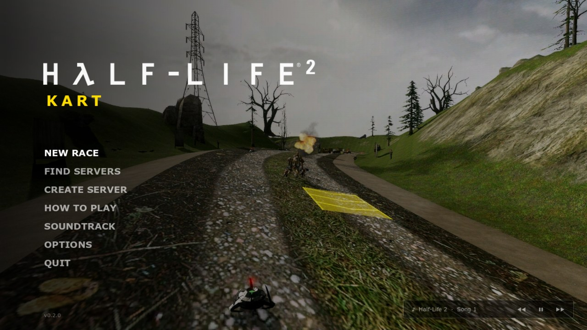</td>
    <td width="33%">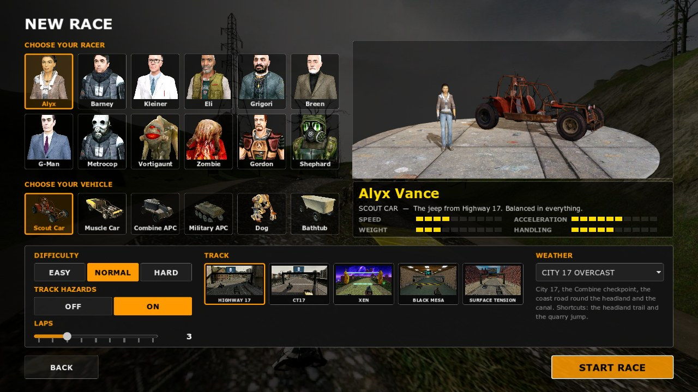</td>
    <td width="33%">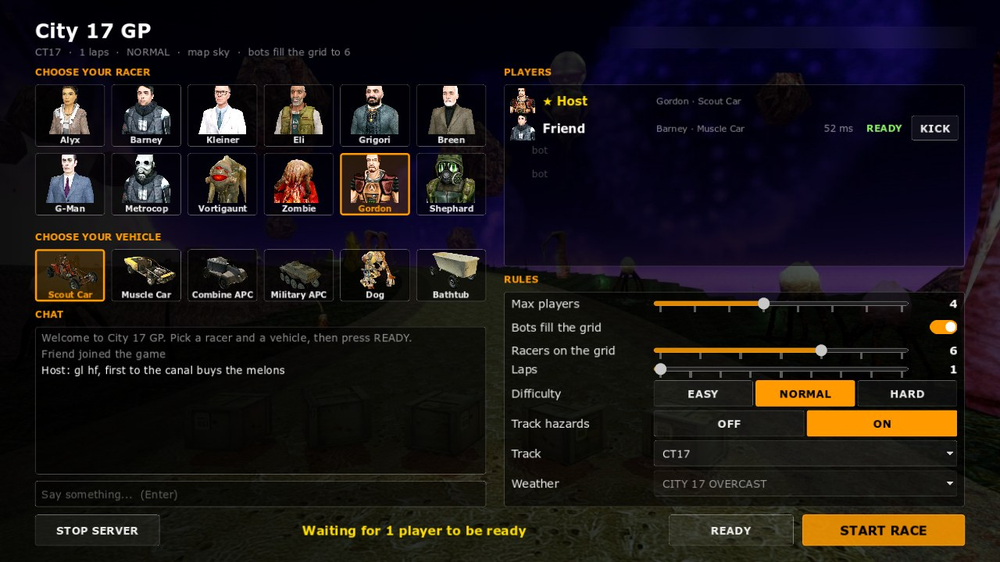</td>
  </tr>
  <tr>
    <td align="center">Main menu</td>
    <td align="center">New race</td>
    <td align="center">Online lobby</td>
  </tr>
</table>

<a id="play"></a>
## Play

1. Have **Half-Life 2** and **Half-Life** installed on Steam (Windows 10 or 11).
2. Download **HL2Kart-v…-windows.exe** from the [latest release](https://github.com/NVG-Games/hl2-kart/releases/latest)
   and run it: it is the whole game in one file, unpacked to `%LOCALAPPDATA%\HL2Kart` on
   its first run.
3. Or take the **.zip** instead, unzip it anywhere and run **Play HL2 Kart.bat**.

The first start finds your two games and builds the game from them: 3 to 6 minutes and
about 2 GB. After that it starts straight into the menu. The download carries Godot and
a small Python, so there is nothing else to install, and nothing from Valve: the game's
content is made on your computer from your own copies. When a new version is out, the
main menu shows a download button. When an update changes the game content (new tracks,
spectators, hazards), its first start builds the content again the same way.

If Windows SmartScreen warns about an unknown app: *More info* → *Run anyway*.

### From source

For development, or to run the latest `dev` code:

- **Godot 4.7** (standard build: the free "Godot Engine" on Steam, or
  [godotengine.org](https://godotengine.org)) and **Python 3.10+** with `numpy` and `Pillow`.

```bash
git clone https://github.com/NVG-Games/hl2-kart.git
cd hl2-kart
pip install numpy pillow
godot --path .
```

The first start builds the content the same way (or run `python tools/setup_assets.py`;
`--only <step>` and `--from <step>` repeat or resume a step:
`extract, music, skies, highway17, tracks, import, ui`).

## Controls

| Action | Keyboard | Gamepad |
|---|---|---|
| Throttle | W / ↑ | A, right trigger |
| Brake / reverse | S / ↓ | X, left trigger |
| Steer | A / D, ← / → | left stick |
| Jump and drift | Shift / Space | RB |
| Use item | E / Ctrl / Enter | LB, B |
| Chat (online) | Y / T | |
| Look back | C | Y |
| Call the scanner | R | Back |
| Pause | Esc / P | Start |

## Multiplayer

The networking works like Source servers: UDP 27015 for the game, 27016 for the server
browser and LAN discovery, and optionally a master server on UDP 27010 for the INTERNET
tab.

- **Host:** CREATE SERVER, set the name, password, player limit, bots, laps, difficulty,
  track hazards, track and weather. The host races too.
- **Join:** FIND SERVERS. On the same network the server shows up under LAN; over the
  internet type the host's address. Without UPnP on the host's router, forward UDP
  27015–27016 or play over a virtual LAN (Radmin VPN, ZeroTier, Tailscale).
- **Same version on every PC:** this build speaks network protocol 3. A server running
  another version shows as *(different version)* in FIND SERVERS and turns you away, so
  everyone updates together.
- **Lobby:** pick a nickname, racer and vehicle; the host changes the rules and starts.
  Track hazards ON or OFF is the host's rule and counts for everyone (the lobby line reads
  "hazards off" when they are off); spectators are each player's own option.
- **Racing:** the start, the countdown and the race clock follow the server, so times and
  results match on every screen. The server waits up to 45 s for a slow PC to load the
  race, then starts, and the late player joins it under way. A player who leaves
  mid-race is replaced by a bot.

Dedicated server (no window, srcds-like console; settings can also go in `server.cfg`,
see `server.cfg.example`):

```bash
godot --headless --path . -- --dedicated --name "City 17 GP" --max 8 --bots on --laps 3 --track xen
```

Track ids: `city17_circuit`, `ct17`, `black_mesa`, `xen`, `surface_tension`.
`--hazards off` (`mp_hazards 0` in `server.cfg`, `set mp_hazards 0` in the console) races
without the track hazards.
Console: `status`, `say <text>`, `kick <nick>`, `start`, `lobby`, `set <cvar> <value>`, `rules`, `quit`.

Master server for the INTERNET tab, on any machine with UDP 27010 open:

```bash
godot --headless --path . -- --master-server --port 27010
```

## Sharing it with friends

- Share the link to the [releases page](https://github.com/NVG-Games/hl2-kart/releases).
  Everyone downloads the zip and builds the content from their own Half-Life 2 and
  Half-Life on the first start, servers included.
- Re-sharing the official zip is fine. Do **not** share a folder after its first start,
  the `assets/` folder or any extracted files: that content belongs to Valve.
- Forks, mods and new tracks are welcome under the same non-commercial license.

## Contributing

Help is welcome: code, new tracks, testing, translations, ideas. Read
[CONTRIBUTING.md](CONTRIBUTING.md), pick an issue labelled `good first issue`, or open one
to discuss an idea. Work happens on the **`dev`** branch (the default); **`main`** only
moves for a release, and every release is listed in [CHANGELOG.md](CHANGELOG.md).

## For developers

- `scripts/`: the game (GDScript). `shaders/`: Source-style shaders.
- `tools/`: Python. VPK, MDL/VVD/VTX, GoldSrc MDL, VTF, VMT and WAD readers;
  `build_track.py` builds Highway 17, `track_gen.py` builds the other circuits from the
  definitions in `tools/circuits/` (a spline of styled stretches: street, open road,
  tunnel or hall, tube, bridge, cutting, jump), with their terrain, props, lights and signs.
  Both take the shortcuts through `branches.py`, the hazards through `hazards.py` and the
  spectators through `crowds.py`. `source_world.py` / `goldsrc_world.py` convert whole
  HL2 / HL1 maps if you want to experiment with real levels.
- `tests/`: headless AI races with stats (`race_stats.tscn`), photo tours, menu layout
  checks (`ui_fit.tscn`), shortcut, hazard and spectator checks (`branch_check.tscn`,
  `hazard_test.tscn`, `crowd_check.tscn`), network walkthroughs and a compile check of
  every script.

A new circuit is one Python module in `tools/circuits/` plus an entry in `TRACKS` in
`scripts/core/game.gd` and in `CIRCUITS` in `tools/setup_assets.py` (see
[CONTRIBUTING.md](CONTRIBUTING.md)). `tools/package_release.py` builds the Windows download; the
*Release build* workflow runs it and drafts the GitHub release when `version.json`
changes on `main`.

## License

The code is © NVG Games under the [PolyForm Noncommercial License 1.0.0](LICENSE.md):
free to use, change and share for any non-commercial purpose. Half-Life content is ©
Valve Corporation and is not included; see [LEGAL.md](LEGAL.md).
