<p align="center">
  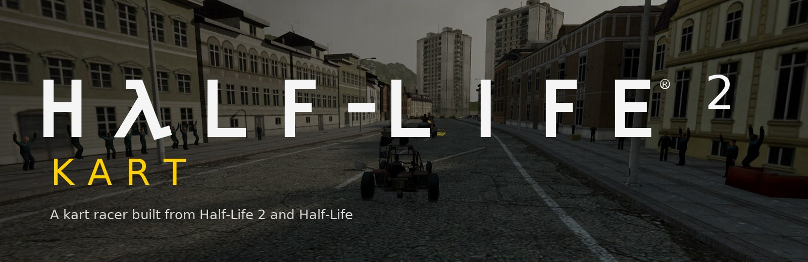
</p>

<p align="center">
  <b>Картинг в духе Mario Kart на Godot 4.7, собранный из ваших копий Half-Life 2 и Half-Life.</b><br>
  Пять больших трасс со срезками · 12 гонщиков · 6 машин · предметы из HL2 · ловушки на трассах · дрифт и турбо · игра по сети и через интернет
</p>

<p align="center">
  
  
  
  
</p>

<p align="center">
  <a href="https://github.com/NVG-Games/hl2-kart/releases/latest"></a>
  <a href="https://github.com/NVG-Games/hl2-kart/releases"></a>
</p>

<p align="center"><a href="README.md">English version</a> · <a href="#play">Как играть</a> · <a href="CONTRIBUTING.md">Участвовать</a></p>

> **Бесплатный некоммерческий фанатский проект, не связанный с Valve.** В репозитории
> только код. Чтобы играть, нужны **Half-Life 2** и **Half-Life** в Steam: один скрипт
> собирает из них все модели, текстуры, звуки и трассы у вас на компьютере.
> Подробности в [LEGAL.md](LEGAL.md).

## Трассы

Круг от 2,1 до 2,5 км, на каждом две срезки, ловушки и зрители вдоль дороги. Дорогу,
стены, тоннели и мосты строят инструменты трасс, а оформляют их текстуры, модели, небо,
вывески и музыка из самих игр.

<table>
  <tr>
    <td width="50%">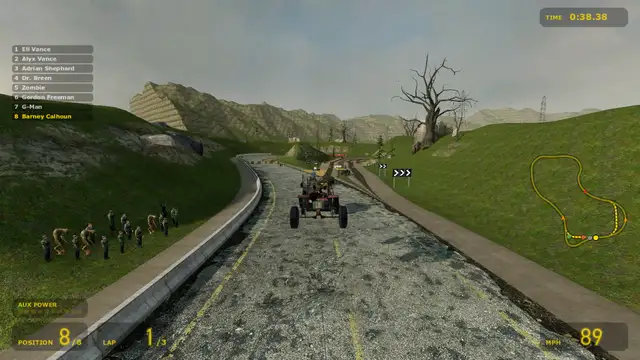</td>
    <td width="50%">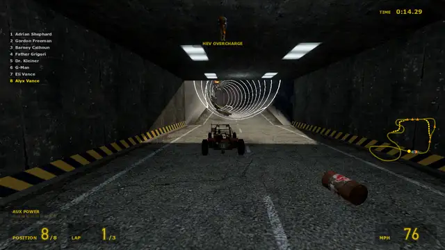</td>
  </tr>
  <tr>
    <td><b>Highway 17</b><br>Из City 17 через блокпост Альянса с силовым полем, вокруг мыса по прибрежному шоссе под огнём штурмовика, прыжок через залив, петля вокруг затопленного карьера, прыгающие мины на грунтовке и обратно по каналу. Погоду можно выбрать.<br><i>Срезки:</i> <b>тропа через мыс</b>, грунтовка с двумя горбами (подойдёт любая скорость, на ней есть ускоритель), и <b>прыжок через карьер</b> напрямик над затопленной ямой (на полном газу, перед трамплином ускоритель; упали в воду, и сканер высадит вас уже за провалом).</td>
    <td><b>CT17</b><br>City 17 под Альянсом, трасса восьмёркой: вокзальная площадь с трансляциями Брина, выемка и тоннель, труба Альянса, где дорога забирается по стене почти под потолок, сортировочная станция с прыжком и поездом Альянса на переезде, поворот у канала под присмотром страйдера, турели на блокпосту, шпильки старого города, эстакада и бульвар к Цитадели.<br><i>Срезки:</i> <b>прыжок через канал</b> напрямик вместо поворота (на полном газу; не долетели до берега, и вы в воде) и <b>крыши</b>: пандус на крыши старого города и прыжок над улицей (нужен разгон от батареи или HEV; не долетели до дальней крыши, и вы на улице внизу).</td>
  </tr>
  <tr>
    <td>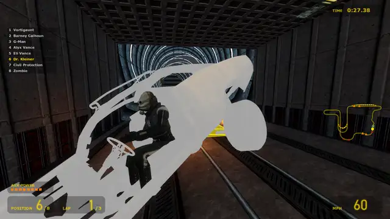</td>
    <td>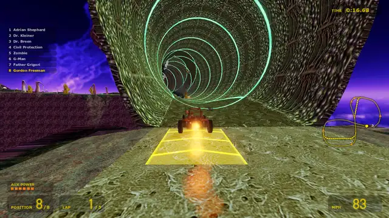</td>
  </tr>
  <tr>
    <td><b>Black Mesa</b><br>Внутри исследовательского комплекса: холл сектора C, верхний переход через зал реактора мимо разрядов ядра «Лямбды», офисы и лаборатории с лазерными растяжками, тоннель монорельса и труба ускорителя, где дорога делает полный оборот, склад с прыжком через кислотную яму и потолочными турелями, переработка отходов со вторым прыжком над кислотой и обратно вокруг ядра на уровне охладителя, где ограждение местами сорвано. Говорит диктор VOX.<br><i>Срезки:</i> <b>кран-балка</b> вдоль стены склада над ямой и турелями (подойдёт любая скорость, на ней есть ускоритель; с её конца вы спрыгиваете обратно на дорогу) и <b>прыжок над охладителем</b> по сломанному мостику через бассейн (перепрыгните разрыв или искупаетесь).</td>
    <td><b>Xen</b><br>Парящие острова над пустотой, трасса восьмёркой: стартовый остров с целебным бассейном, мост из корней, живая пещера, где дорога делает полный оборот, хаундаи на островах, вортигонты с молниями на кристальном плато, прыжок через пропасть, уступ без перил к арке над мостом из корней и щупальце у длинного моста к старту. Вдалеке следит Нихилант.<br><i>Срезки:</i> <b>высокий корень</b>, узкий корень над пустотой даже без бортика, в конце прыжок вниз на настил, и <b>прыжки по островам</b> через пустоту по двум парящим скалам (два прыжка, нужна скорость).</td>
  </tr>
  <tr>
    <td>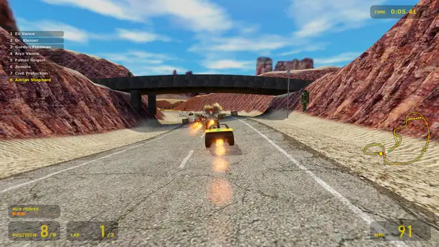</td>
    <td>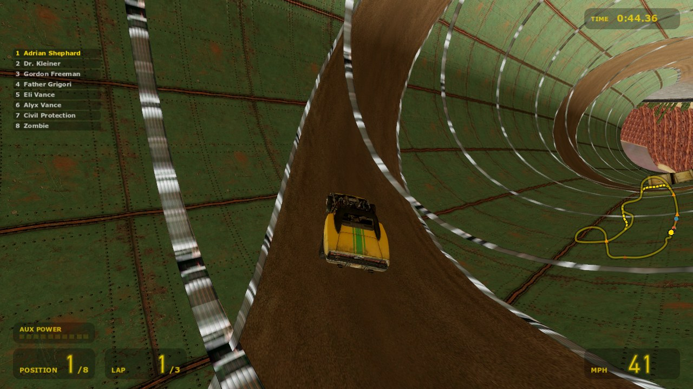</td>
  </tr>
  <tr>
    <td colspan="2"><b>Surface Tension</b><br>Пустыня у Чёрной Мезы: «Апач» над стартовой прямой, размытая дорога с прыжком, шпилька вниз в каньон из красного камня, стальной мост над ущельем реки, лагерь HECU с «Оспреем», турелями и прыжком, водовод плотины, где дорога дважды проходит по кругу трубы, дорога над обрывом почти без ограждения, миномётный обстрел на гребне плотины и виадук обратно над стартовой прямой.<br><i>Срезки:</i> <b>спуск с обрыва</b>, грунтовка по краю каньона без ограждения, в конце прыжок вниз на дорогу у подножия шпильки (нужна скорость; не долетели, и вы на дне каньона), и <b>размытый брод</b>, прыжок через реку с разрушенной насыпи вместо объезда по мосту через ущелье (перед трамплином ускоритель; не долетели, и вы в реке).</td>
  </tr>
</table>

## Гонщики и машины

<p align="center">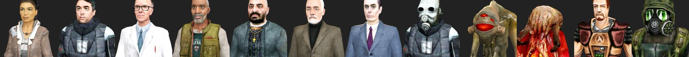</p>

Аликс, Барни, Кляйнер, Илай, отец Григорий, доктор Брин, G-Man, метрокоп, вортигонт и
зомби из Half-Life 2, а также Гордон Фримен и Адриан Шепард из Half-Life. Каждый
говорит своими репликами из игр.

<p align="center">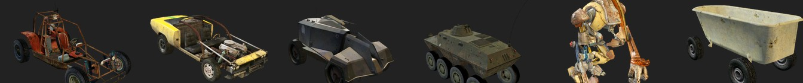</p>

Багги, маслкар Гордона из Episode Two, Combine APC, армейский БТР, Дог (несёт гонщика
на плечах) и ванна на колёсах. У каждой своя скорость, разгон, масса, управляемость и
звук мотора.

## Возможности

- **Предметы** из ящиков снабжения HL2: самонаводящийся мэнхек, роллермина, взрывная
  бочка, ускорение от батареи HEV, гравипушка, капсула хедкрабов по лидеру, щит от
  зарядника HEV, энергошар AR2 (отскакивает от стен), арбузы, на которых заносит,
  прыгающая мина, циркулярная пила из Рейвенхолма, хедкрабы на лица ближайших гонщиков
  впереди и телепорт Зена вперёд по трассе.
- **Срезки:** по две на каждой трассе. Развилки отмечены щитами со стрелками, при первом
  подъезде HUD называет срезку, а миникарта рисует срезки пунктиром. Почти все кончаются
  прыжком, которому нужна скорость или ускорение; не допрыгнули, и сканер даст ещё одну
  попытку с разгона, если с места прыжок ещё можно взять.
- **Ловушки на трассах:** силовое поле, турели, поезд Альянса, страйдер, штурмовик,
  прыгающие мины, лазерные растяжки, хаундаи, вортигонты, щупальце, «Апач» и миномёты. Каждая ловушка
  предупреждает перед ударом, красная стрелка у края экрана показывает, кто взял вас на
  прицел, а за один проезд группы ловушек попасть в вас могут только раз. Выключаются в
  NEW RACE переключателем TRACK HAZARDS.
- **Зрители:** вдоль дорог стоят горожане, повстанцы, метрокопы, учёные, охранники,
  морпехи HECU и вортигонты. Они радуются старту и финишу, вздрагивают от взрывов,
  отскакивают от машин, а некоторые узнают вашего гонщика: метрокопы осуждают Гордона и
  отдают честь доктору Брину, морпехи салютуют Шепарду. Поглядывайте, не стоит ли где
  G-Man; ещё несколько пасхалок оставим вам найти самим. Меньше зрителей или ни одного:
  Options > Video > Spectators.
- **Трубы и открытые края:** в светящейся трубе дорога уходит на стену и потолок; у
  некоторых мостов и дорог над обрывом нет ограждения, и широкая траектория кончается падением.
- **Дрифт:** зажмите прыжок в повороте, дайте зарядиться шкале AUX POWER и отпустите
  для мини- или супер-турбо. Газ на счёт «one» даёт ракетный старт.
- **Спасение:** въехали в воду или кислоту, и машина с брызгами тонет, а сканер Альянса
  её вытаскивает; вылетели, застряли или оказались за стеной, и он вернёт вас на дорогу.
  Поехали против хода, и замигает WRONG WAY.
- **Мультиплеер:** LAN и интернет, браузер серверов как в Half-Life, лобби с чатом, боты
  на пустых местах, выделенный сервер и мастер-сервер.
- **Как в Source:** шейдеры в духе VertexLitGeneric / LightmappedGeneric, небо HL2 и HL1,
  `sv_gravity 600`, свойства машин и поверхностей из скриптов игры, музыка HL2 и HL1.

<table>
  <tr>
    <td width="33%">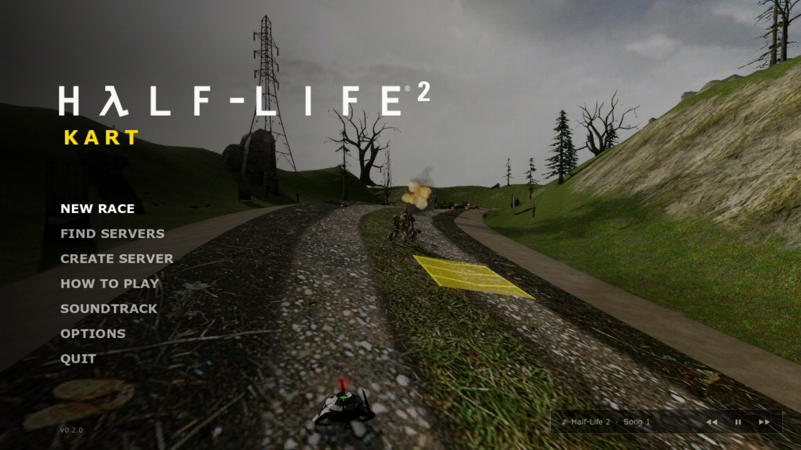</td>
    <td width="33%">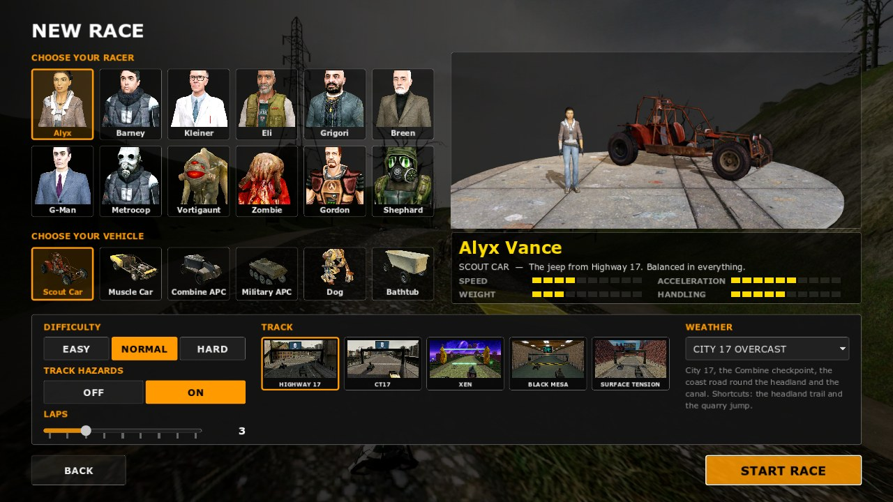</td>
    <td width="33%">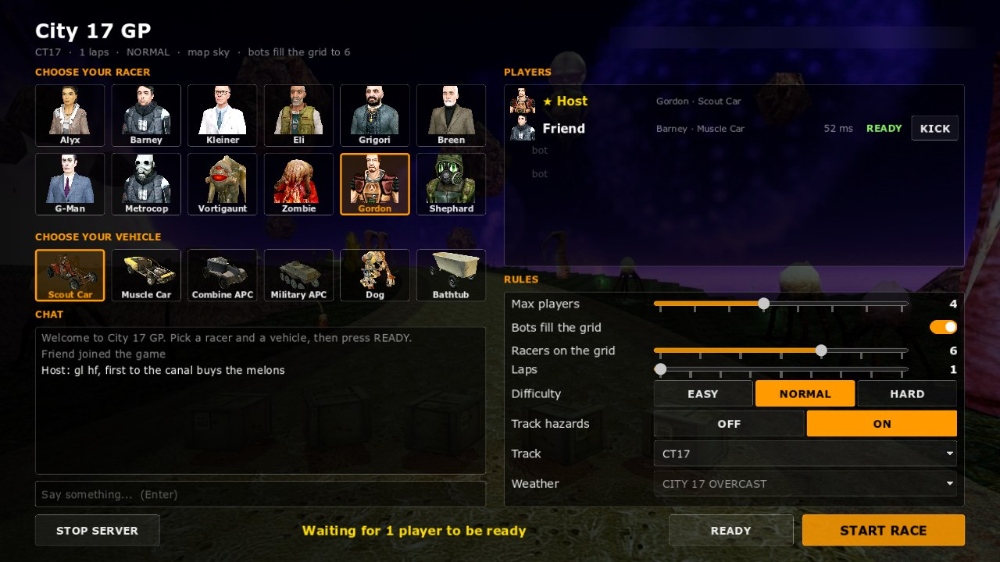</td>
  </tr>
  <tr>
    <td align="center">Главное меню</td>
    <td align="center">Новая гонка</td>
    <td align="center">Сетевое лобби</td>
  </tr>
</table>

<a id="play"></a>
## Как играть

1. Установите **Half-Life 2** и **Half-Life** в Steam (Windows 10 или 11).
2. Скачайте **HL2Kart-v…-windows.zip** из [последнего релиза](https://github.com/NVG-Games/hl2-kart/releases/latest)
   и распакуйте куда угодно.
3. Запустите **Play HL2 Kart.bat**.

При первом запуске игра находит обе игры и собирает из них всё нужное: от 3 до 6 минут и
около 2 ГБ. Дальше она сразу открывает меню. В архиве уже есть Godot и небольшой Python,
ставить ничего не нужно, и нет ничего от Valve: контент делается у вас на компьютере из
ваших копий. Когда выйдет новая версия, в главном меню появится кнопка скачать. Если
обновление меняет контент игры (новые трассы, зрители, ловушки), при первом запуске после
него контент собирается заново тем же способом.

Если Windows SmartScreen предупреждает о неизвестном приложении: *Подробнее* → *Выполнить в любом случае*.

### Из исходников

Для разработки или чтобы запустить свежий код из ветки `dev`:

- **Godot 4.7** (обычная сборка: бесплатный «Godot Engine» в Steam или
  [godotengine.org](https://godotengine.org)) и **Python 3.10+** с пакетами `numpy` и `Pillow`.

```bash
git clone https://github.com/NVG-Games/hl2-kart.git
cd hl2-kart
pip install numpy pillow
godot --path .
```

При первом запуске контент собирается так же (или через `python tools/setup_assets.py`;
`--only <шаг>` и `--from <шаг>` повторяют или продолжают шаг:
`extract, music, skies, highway17, tracks, import, ui`).

## Управление

| Действие | Клавиатура | Геймпад |
|---|---|---|
| Газ | W / ↑ | A, правый триггер |
| Тормоз / задний ход | S / ↓ | X, левый триггер |
| Руль | A / D, ← / → | левый стик |
| Прыжок и дрифт | Shift / Пробел | RB |
| Предмет | E / Ctrl / Enter | LB, B |
| Чат (в сетевой игре) | Y / T | |
| Взгляд назад | C | Y |
| Вызвать сканер | R | Back |
| Пауза | Esc / P | Start |

## Мультиплеер

Сеть устроена как у серверов Source: UDP 27015 для игры, 27016 для браузера серверов и
поиска в локальной сети, и по желанию мастер-сервер на UDP 27010 для вкладки INTERNET.

- **Свой сервер:** CREATE SERVER, имя, пароль, максимум игроков, боты, круги, сложность,
  ловушки, трасса и погода. Хост тоже гоняет.
- **Подключение:** FIND SERVERS. В одной сети сервер появится во вкладке LAN, через
  интернет введите адрес хоста. Если у хоста роутер без UPnP, пробросьте UDP
  27015–27016 или играйте через виртуальную сеть (Radmin VPN, ZeroTier, Tailscale).
- **Одна версия на всех компьютерах:** эта сборка работает по сетевому протоколу 3.
  Сервер другой версии в FIND SERVERS помечен *(different version)* и не пустит вас,
  так что обновляйтесь вместе.
- **Лобби:** ник, гонщик и машина; хост меняет правила и запускает гонку. Ловушки (ON или
  OFF) выбирает хост, и это правило для всех (в строке лобби тогда видно «hazards off»);
  зрители у каждого свои, в его настройках.
- **Гонка:** старт, отсчёт и время гонки идут по часам сервера, поэтому время и итоги у
  всех совпадают. Сервер ждёт медленный компьютер до 45 с, потом стартует, а опоздавший
  подключается к уже идущей гонке. Если игрок вышел посреди гонки, его машину ведёт бот.

Выделенный сервер (без окна, консоль как у srcds; настройки можно положить в
`server.cfg`, образец в `server.cfg.example`):

```bash
godot --headless --path . -- --dedicated --name "City 17 GP" --max 8 --bots on --laps 3 --track xen
```

Трассы: `city17_circuit`, `ct17`, `black_mesa`, `xen`, `surface_tension`.
`--hazards off` (`mp_hazards 0` в `server.cfg`, `set mp_hazards 0` в консоли) убирает
ловушки с трассы.
Консоль: `status`, `say <текст>`, `kick <ник>`, `start`, `lobby`, `set <параметр> <значение>`, `rules`, `quit`.

Мастер-сервер для вкладки INTERNET, на любом компьютере с открытым UDP 27010:

```bash
godot --headless --path . -- --master-server --port 27010
```

## Как делиться игрой

- Делитесь ссылкой на [страницу релизов](https://github.com/NVG-Games/hl2-kart/releases).
  Каждый скачивает архив и при первом запуске собирает контент из своих Half-Life 2 и
  Half-Life, сервер тоже.
- Сам официальный архив можно передавать. **Не выкладывайте** папку игры после первого
  запуска, папку `assets/` или извлечённые файлы: этот контент принадлежит Valve.
- Форки, моды и новые трассы приветствуются на тех же некоммерческих условиях.

## Участие в разработке

Помощь приветствуется: код, новые трассы, тестирование, переводы, идеи. Прочитайте
[CONTRIBUTING.md](CONTRIBUTING.md), возьмите задачу с меткой `good first issue` или
откройте свою, чтобы обсудить идею. Работа идёт в ветке **`dev`** (она основная), а
**`main`** двигается только при выпуске версии; все версии описаны в [CHANGELOG.md](CHANGELOG.md).

## Разработчикам

- `scripts/`: игра на GDScript. `shaders/`: шейдеры в стиле Source.
- `tools/`: Python. Чтение VPK, MDL/VVD/VTX, GoldSrc MDL, VTF, VMT и WAD;
  `build_track.py` строит Highway 17, `track_gen.py` строит остальные трассы по
  описаниям в `tools/circuits/` (сплайн из участков разного типа: улица, открытая
  дорога, тоннель или зал, труба, мост, выемка, прыжок) вместе с рельефом, пропами,
  светом и вывесками. Оба скрипта берут срезки из `branches.py`, ловушки из `hazards.py`,
  зрителей из `crowds.py`. `source_world.py` / `goldsrc_world.py` переводят целые карты HL2 / HL1,
  если хочется поэкспериментировать с настоящими уровнями.
- `tests/`: безоконные заезды AI со статистикой (`race_stats.tscn`), фототуры, проверка
  разметки меню (`ui_fit.tscn`), проверки срезок, ловушек и зрителей (`branch_check.tscn`,
  `hazard_test.tscn`, `crowd_check.tscn`), сетевые прогоны и проверка компиляции всех
  скриптов.

Новая трасса: один модуль Python в `tools/circuits/` и запись в `TRACKS` в
`scripts/core/game.gd`. `tools/package_release.py` собирает архив для Windows; workflow
*Release build* запускает его и готовит черновик релиза на GitHub, когда в `main` меняется
`version.json`.

## Лицензия

Код © NVG Games, лицензия [PolyForm Noncommercial 1.0.0](LICENSE.md): его можно
бесплатно использовать, менять и распространять в любых некоммерческих целях. Контент
Half-Life © Valve Corporation и в репозиторий не входит, см. [LEGAL.md](LEGAL.md).
