<p align="center">
  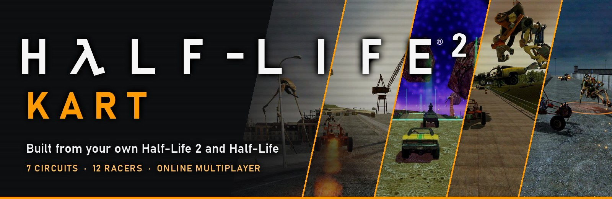
</p>

<p align="center">
  <b>Картинг в духе Mario Kart на Godot 4.7, собранный из ваших копий Half-Life 2 и Half-Life.</b><br>
  Семь больших трасс со срезками · 12 гонщиков · 6 машин · предметы из HL2 · ловушки на трассах · дрифт и турбо · игра по сети и через интернет
</p>

<p align="center">
  
  
  
  
</p>

<p align="center">
  <a href="https://github.com/NVG-Games/hl2-kart/releases/latest"></a>
  <a href="https://github.com/NVG-Games/hl2-kart/releases"></a>
</p>

<p align="center"><a href="README.md">English version</a> · <a href="#new">Что нового</a> · <a href="#play">Как играть</a> · <a href="CONTRIBUTING.md">Участвовать</a></p>

> **Бесплатный некоммерческий фанатский проект, не связанный с Valve.** В репозитории
> только код. Чтобы играть, нужны **Half-Life 2** и **Half-Life** в Steam: один скрипт
> собирает из них все модели, текстуры, звуки и трассы у вас на компьютере.
> Подробности в [LEGAL.md](LEGAL.md).

<a id="new"></a>
## Новое в 0.3.0

<table>
  <tr>
    <td width="33%">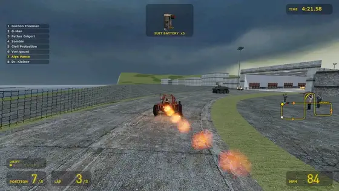</td>
    <td width="33%">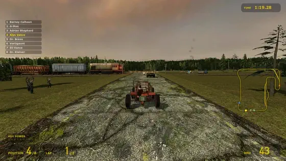</td>
    <td width="33%">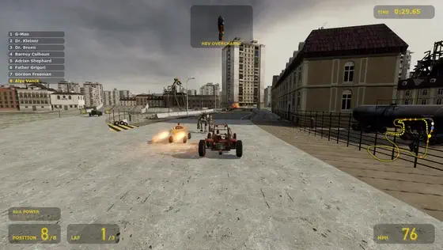</td>
  </tr>
  <tr>
    <td align="center" valign="top"><b>Nova Prospekt</b> (новая): пузырь телепорта Альянса вернёт на трассу</td>
    <td align="center" valign="top"><b>White Forest</b> (новая): шлагбаум опущен, ждём поезд</td>
    <td align="center" valign="top"><b>CT17 в руинах</b>: три страйдера охотятся на любую машину</td>
  </tr>
  <tr>
    <td>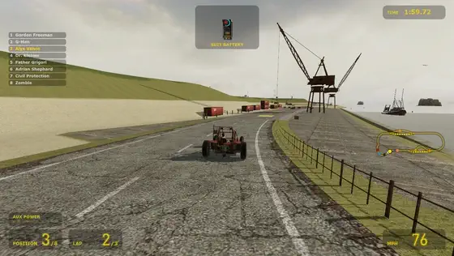</td>
    <td>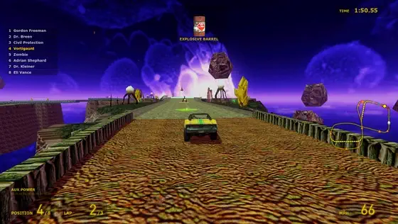</td>
    <td>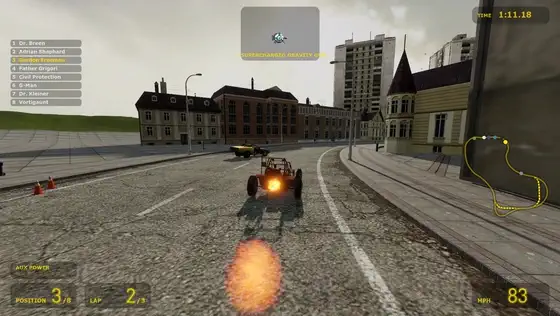</td>
  </tr>
  <tr>
    <td align="center" valign="top"><b>Highway 17 у моря</b>: берегитесь магнита портового крана</td>
    <td align="center" valign="top"><b>Xen ожил</b>: буллсквиды плюются кислотой на дорогу</td>
    <td align="center" valign="top"><b>Усиленная гравипушка</b>: машины впереди улетают в небо</td>
  </tr>
</table>

При первом запуске после обновления контент один раз соберётся заново. В сетевой игре
версия 0.3.0 нужна всем.

С двумя новыми трассами их теперь семь. Highway 17 переехала на побережье, CT17 лежит в
руинах, а обитатели Xen проснулись. Спасают теперь на каждой трассе по-своему, всего шесть
видов спасения: сканер фотографирует вас, кран повстанцев вытаскивает магнитом, вортигонты возвращают своими
лучами. Гравипушка переносит машину впереди над вами и бросает позади, Дог бегает с
анимациями из самой Half-Life 2, а у ванны появились два пропановых баллона-движка. Все
изменения в [CHANGELOG.md](CHANGELOG.md#unreleased).

## Трассы

Круг от 2,1 до 2,7 км, на каждом две срезки, ловушки и зрители вдоль дороги. Дорогу,
стены, тоннели и мосты строят инструменты трасс, а оформляют их текстуры, модели, небо,
вывески и музыка из самих игр. Nova Prospekt и White Forest появились в 0.3.0.

<table>
  <tr>
    <td width="50%">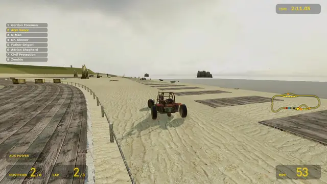</td>
    <td width="50%">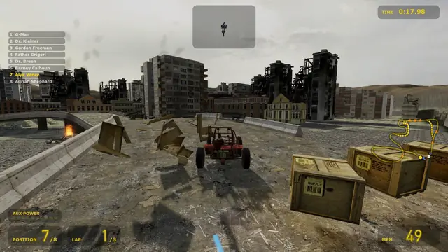</td>
  </tr>
  <tr>
    <td valign="top"><b>Highway 17</b>: побережье из Half-Life 2, штурмовик над мостом через залив и тоннель, где дорога идёт по потолку.<br>
      <sub><b>Ловушки:</b> штурмовик, магнитный кран, муравьиные львы · <b>Срезки:</b> старый мост, доски по песку · <b>Спасение:</b> магнитный кран повстанцев</sub>
      <details><summary>Весь круг</summary>Побережье из Half-Life 2, «Шоссе 17» и «Песчаные ловушки»: шоссе на обрыве над морем, длинный мост через морской залив под огнём штурмовика, тоннель в мысе, где дорога делает полный оборот по стенам и потолку, дорога по обрыву вниз к докам и магнитному крану повстанцев, деревянный мост через устье залива и пляж муравьиных львов, где ехать можно только по дощатому настилу (съедете на песок, и муравьиные львы проснутся), а потом подъём по восточному обрыву обратно на шоссе. Вдоль шоссе брошенные машины и сгоревший БТР Альянса, у доков болеют повстанцы из своего лагеря, тампер Альянса держит в покое последний кусок пляжа, на восточном мысу стоит маяк. Вылетели с дороги, и кран повстанцев вытащит вас магнитом.<br><br><i>Срезки:</i> <b>старый мост</b>, старый прибрежный мост напрямик через залив, его средний пролёт рухнул в воду (нужна скорость; не долетели, и вы в воде), и <b>доски по песку</b>, доски, уложенные прямо вдоль берега, с песком между каждой (короче, чем настил в обход дюн, но в каждом промежутке песок).</details>
    </td>
    <td valign="top"><b>CT17</b>: разрушенный City 17, восьмёрка среди пожаров, завалов и взорванного дома, а рядом бродят три страйдера.<br>
      <sub><b>Ловушки:</b> три страйдера, поезд Альянса, напольные турели · <b>Срезки:</b> прыжок через канал, крыши · <b>Спасение:</b> сканер фотографирует вас</sub>
      <details><summary>Весь круг</summary>Разрушенный City 17, трасса восьмёркой: вокзальная площадь с трансляциями Брина, выемка и тоннель, разбитый виадук над каналом с обрушенным пролётом (дорога ныряет по его плите вниз и снова вверх), сортировочная станция с прыжком и поездом Альянса на переезде, поворот у канала, турели на блокпосту, шпильки старого города, эстакада и бульвар к Цитадели: в пролом в фасаде дома, через первый этаж и наружу через другой пролом, по завалу на крышу рухнувшего дома и вниз по упавшей плите перекрытия. Среди завалов, сгоревших машин и выпотрошенных домов горят пожары и поднимается дым, а вдоль дороги шагают три страйдера и бьют по всем, кто рядом, из пушки и пулемёта.<br><br><i>Срезки:</i> <b>прыжок через канал</b> напрямик вместо поворота (на полном газу; не долетели до берега, и вы в воде) и <b>крыши</b>: длинный путь поверху вместо шпилек старого города, пандус спиралью на крыши, три прыжка через переулки и спуск по обрушенной плите на улицу (разгон не нужен; не долетели до крыши, и вы в переулке, прыжок заново).</details>
    </td>
  </tr>
  <tr>
    <td>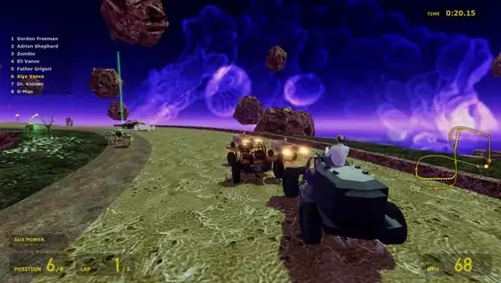</td>
    <td>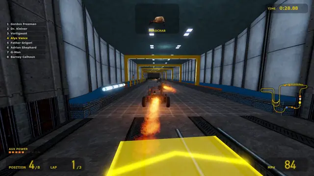</td>
  </tr>
  <tr>
    <td valign="top"><b>Xen</b>: парящие острова над пустотой, прыжки в пониженной гравитации, мосты из живых корней и очень бодрые местные.<br>
      <sub><b>Ловушки:</b> контроллеры, хаундаи, буллсквиды, вортигонты, щупальце · <b>Срезки:</b> высокий корень, прыжки по островам · <b>Спасение:</b> портал Xen</sub>
      <details><summary>Весь круг</summary>Парящие острова над пустотой, трасса восьмёркой: стартовый остров с целебным бассейном, мост из корней, затем мосты, выросшие из живых корней, к трём маленьким парящим островам, через которые прыгаешь в пониженной гравитации Xen, долго и плавно паря над пустотой, и обратно вверх на плато. Xen живой: над пустотой у моста из корней и у арки парят контроллеры и бросают медленные оранжевые шары туда, где вы окажетесь, стаи хаундаев ходят по обочинам и выбегают к краю дороги, чтобы ударить звуком, буллсквиды на краях островов плюются кислотой, и на дороге остаётся светящаяся лужа, вортигонты бьют молниями на кристальном плато. Дальше прыжок через пропасть, уступ без перил к арке над мостом из корней и щупальце у длинного моста к старту. Вдалеке следит Нихилант.<br><br><i>Срезки:</i> <b>высокий корень</b>, узкий корень над пустотой даже без бортика, в конце прыжок вниз на настил, и <b>прыжки по островам</b> через пустоту по двум парящим скалам (два прыжка, нужна скорость).</details>
    </td>
    <td valign="top"><b>Black Mesa</b>: внутри исследовательского комплекса, дважды через зал реактора, вдоль пучка ускорителя и над двумя кислотными ямами.<br>
      <sub><b>Ловушки:</b> лазерные растяжки, потолочные турели, разряды ядра «Лямбды» · <b>Срезки:</b> кран-балка, прыжок над охладителем · <b>Спасение:</b> телепорт Black Mesa</sub>
      <details><summary>Весь круг</summary>Внутри исследовательского комплекса: холл сектора C, верхний переход через зал реактора мимо разрядов ядра «Лямбды», офисы и лаборатории с лазерными растяжками, тоннель монорельса и служебный тоннель ускорителя, ровный и быстрый, вдоль пучка: светящаяся труба пучка идёт сквозь синие магниты под жёлтыми арками кольцевых магнитов, склад с прыжком через кислотную яму и потолочными турелями, переработка отходов со вторым прыжком над кислотой и обратно вокруг ядра на уровне охладителя, где ограждение местами сорвано. Говорит диктор VOX.<br><br><i>Срезки:</i> <b>кран-балка</b> вдоль стены склада над ямой и турелями (подойдёт любая скорость, на ней есть ускоритель; с её конца вы спрыгиваете обратно на дорогу) и <b>прыжок над охладителем</b> по сломанному мостику через бассейн (перепрыгните разрыв или искупаетесь).</details>
    </td>
  </tr>
  <tr>
    <td>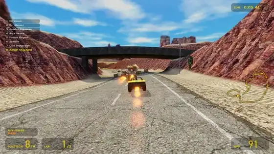</td>
    <td>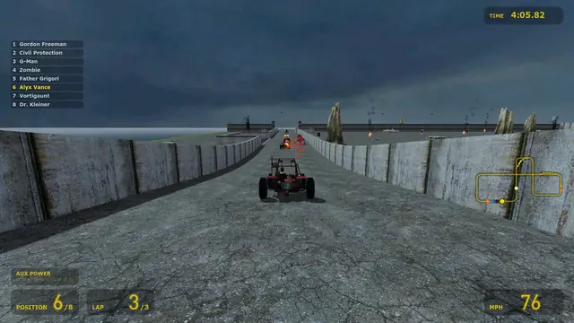</td>
  </tr>
  <tr>
    <td valign="top"><b>Surface Tension</b>: пустыня у Чёрной Мезы, «Апач», каньон из красного камня, лагерь HECU и миномёты на плотине.<br>
      <sub><b>Ловушки:</b> «Апач», турели HECU, миномёты · <b>Срезки:</b> спуск с обрыва, размытый брод · <b>Спасение:</b> телепорт Black Mesa</sub>
      <details><summary>Весь круг</summary>Пустыня у Чёрной Мезы: «Апач» над стартовой прямой, размытая дорога с прыжком, шпилька вниз в каньон из красного камня, стальной мост над ущельем реки, лагерь HECU с «Оспреем», турелями и прыжком, сухой водосброс плотины, бетонный канал в толще горы, над которым проходит водовод, дорога над обрывом почти без ограждения, миномётный обстрел на гребне плотины и виадук обратно над стартовой прямой.<br><br><i>Срезки:</i> <b>спуск с обрыва</b>, грунтовка по краю каньона без ограждения, в конце прыжок вниз на дорогу у подножия шпильки (нужна скорость; не долетели, и вы на дне каньона), и <b>размытый брод</b>, прыжок через реку с разрушенной насыпи вместо объезда по мосту через ущелье (перед трамплином ускоритель; не долетели, и вы в реке).</details>
    </td>
    <td valign="top"><b>Nova Prospekt</b> <sup>NEW</sup>: тюрьма Альянса на морском обрыве, в два этажа, а на обрушенном дворе ждёт страж муравьиных львов.<br>
      <sub><b>Ловушки:</b> страж муравьиных львов, напольные турели · <b>Срезки:</b> верхний ярус, вентиляционный короб · <b>Спасение:</b> телепорт Альянса</sub>
      <details><summary>Весь круг</summary>Тюрьма Альянса на морском обрыве, в два этажа: из въездного двора под высоким переходом через проездную башню на первый этаж корпуса A с высоким залом, столовая с плиткой и длинный подъём на верхний ярус: переходы над обоими дворами, крыша депо и галерея разрушенного корпуса, пол которого провалился в пещеры муравьиных львов. Дальше вниз, на обрушенный двор, где из-под пола вырывается страж муравьиных львов и бросается в атаку: догонит, и столкнёт вас в провал рядом с дорогой, и вы упадёте в пещеры муравьиных львов из Episode Two, освещённые светящимися личинками. Выбирайтесь сами, по скальной выемке на дорогу над обрывом: выедете почти вровень с остальными, а сверх того получите долгое ускорение и, если у вас нет предмета, один из самых сильных предметов. Потом через западные ворота на дорогу по обрыву между внешней стеной и забором, далеко внизу море, и обратно через прачечную. В столовой стоят напольные турели, со дворов и крыш смотрят тюремные охранники Альянса. Съехали с дороги, и телепорт Альянса возвращает вас на неё.<br><br><i>Срезки:</i> <b>верхний ярус</b>, галерея вдоль стены корпуса A, с пола вверх мимо камер, в конце вы спрыгиваете обратно на пол (на ней есть ускоритель), и <b>вентиляционный короб</b>, узкий короб по крыше депо, срезающий её угол.</details>
    </td>
  </tr>
  <tr>
    <td>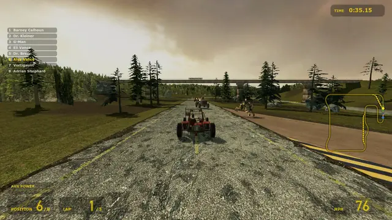</td>
    <td rowspan="2" align="center"><b>Здесь могла быть ваша трасса</b><br>Для трассы нужен один модуль Python в <code>tools/circuits/</code> и запись в двух списках. Как это сделать, рассказано в <a href="CONTRIBUTING.md">CONTRIBUTING.md</a>.</td>
  </tr>
  <tr>
    <td valign="top"><b>White Forest</b> <sup>NEW</sup>: сосновый лес из Episode Two, поезда, мост-качели и колонна Альянса, которая стреляет сверху.<br>
      <sub><b>Ловушки:</b> колонна Альянса, мост-качели, товарный поезд на переезде · <b>Срезки:</b> лесовозная тропа, цех лесопилки · <b>Спасение:</b> вортигонты</sub>
      <details><summary>Весь круг</summary>Лес из Episode Two по дороге на базу Белая Роща: разбитый асфальт и лесовозные дороги среди сосен. От старта вдоль железной дороги, где по ту сторону забора с вами может наперегонки идти товарный поезд, вниз в скальную выемку под железнодорожным мостом и на дорогу у ущелья, к мосту-качелям: стальной пролёт на оси над ущельем реки наклоняется в ту сторону, где машины, так что по нему то въезжаешь вверх, то скатываешься вниз. Вокруг восточного холма и вниз в долину под высокий мост, по которому марширует колонна Альянса (над дорогой она останавливается, отмечает красными полосами место, где будут машины, и через мгновение открывает огонь: смените полосу), по шпильке в конце долины и снова под тем же мостом, через выемку в гребне, вдоль реки, через двор лесопилки и по мосту у мельницы, потом вверх по западному берегу и через железную дорогу по переезду, где шлагбаумы опускаются задолго до того, как пройдёт короткий поезд. На запасных путях стоят составы, рядом с одним лежит сошедший с рельсов вагон, в реке под мостом-качелями лежат вагоны, упавшие вместе со старым мостом, а с обочин и из своего лагеря смотрят повстанцы и вортигонты. Съехали с дороги, и вортигонты вытягивают вас обратно своей зелёной энергией.<br><br><i>Срезки:</i> <b>лесовозная тропа</b> среди сосен с прыжком через сухой овраг (не долетели, и вы в овраге) и <b>цех лесопилки</b>: напрямик через длинный цех, пока дорога по двору огибает штабеля брёвен.</details>
    </td>
  </tr>
</table>

## Гонщики и машины

<p align="center">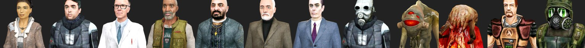</p>

Аликс, Барни, Кляйнер, Илай, отец Григорий, доктор Брин, G-Man, метрокоп, вортигонт и
зомби из Half-Life 2, а также Гордон Фримен и Адриан Шепард из Half-Life. Каждый
говорит своими репликами из игр.

<p align="center">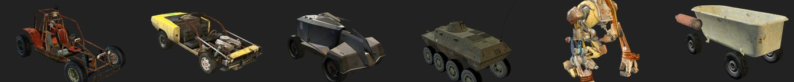</p>

Багги, маслкар Гордона из Episode Two, Combine APC, армейский БТР, Дог (несёт гонщика
на плечах) и ванна на колёсах с двумя пропановыми баллонами-движками, как в Garry's Mod.
У каждой своя скорость, разгон, масса, управляемость и звук мотора.

## Возможности

- **Предметы** из ящиков снабжения HL2, всего четырнадцать: самонаводящийся мэнхек,
  роллермина, взрывная бочка, ускорение от батареи HEV, гравипушка (переносит машину
  впереди над вами и бросает позади), усиленная гравипушка из Цитадели (подбрасывает машины
  впереди в небо), капсула хедкрабов по лидеру, перегрузка HEV (семь секунд неуязвимости,
  и всех, кого вы коснулись, отбрасывает), энергошар AR2 (отскакивает от стен), арбузы, на которых
  заносит, прыгающая мина, циркулярная пила из Рейвенхолма, хедкрабы на лица ближайших
  гонщиков впереди и телепорт Xen на 140 м вперёд по трассе. Батареи, мэнхеки и арбузы
  бывают и по три.
- **Срезки:** по две на каждой трассе. Развилки отмечены щитами со стрелками, при первом
  подъезде HUD называет срезку, а миникарта рисует срезки пунктиром. Почти все кончаются
  прыжком, которому нужна скорость или ускорение; не допрыгнули, и спасение даст ещё одну
  попытку с разгона, если с места прыжок ещё можно взять.
- **Ловушки на трассах:** турели, страйдеры, поезд Альянса, штурмовик, магнитный кран,
  муравьиные львы под песком, страж муравьиных львов, лазерные растяжки, разряды ядра
  «Лямбды», контроллеры, хаундаи, буллсквиды, вортигонты, щупальце, «Апач», миномёты,
  товарный поезд на переезде и колонна Альянса на мосту. Каждая ловушка предупреждает
  перед ударом, красная стрелка у края экрана показывает, кто взял вас на прицел, а за
  один проезд группы ловушек попасть в вас могут только раз. Выключаются в NEW RACE
  переключателем TRACK HAZARDS.
- **Своё спасение на каждой трассе:** въехали в воду или кислоту, и машина с брызгами
  тонет; вылетели, застряли или оказались за стеной, и придёт помощь (R зовёт её сразу).
  На CT17 прилетает сканер Альянса и фотографирует вас, на Highway 17 кран повстанцев
  опускает с неба магнит и поднимает вас обратно на дорогу, в Black Mesa и на Surface
  Tension вокруг вас разгорается телепорт Black Mesa, на Xen вас проглатывает портал Xen,
  в Nova Prospekt телепорт Альянса окутывает вас бело-голубым пузырём, в White Forest
  вортигонты вытягивают вас своей зелёной энергией. После вспышки вы уже на дороге.
  Поехали против хода, и замигает WRONG WAY.
- **Зрители:** вдоль дорог стоят горожане, повстанцы, метрокопы, учёные, охранники,
  морпехи HECU и вортигонты. Они радуются старту и финишу, вздрагивают от взрывов,
  отскакивают от машин, а некоторые узнают вашего гонщика: метрокопы осуждают Гордона и
  отдают честь доктору Брину, морпехи салютуют Шепарду. Поглядывайте, не стоит ли где
  G-Man; ещё несколько пасхалок оставим вам найти самим. Меньше зрителей или ни одного:
  Options > Video > Spectators.
- **Низкая гравитация, труба и открытые края:** на Xen вы долго парите над пустотой между
  островами, в тоннеле сквозь мыс на Highway 17 дорога уходит на стену и потолок, мост-качели
  в White Forest наклоняется под машинами, а у некоторых мостов и дорог над обрывом нет
  ограждения, и широкая траектория кончается падением.
- **Дрифт:** зажмите прыжок в повороте, дайте зарядиться шкале AUX POWER и отпустите
  для мини- или супер-турбо. Газ на счёт «one» даёт ракетный старт.
- **Мультиплеер:** LAN и интернет, браузер серверов как в Half-Life, лобби с чатом, боты
  на пустых местах, выделенный сервер и мастер-сервер.
- **Как в Source:** шейдеры в духе VertexLitGeneric / LightmappedGeneric, небо HL2 и HL1,
  `sv_gravity 600`, свойства машин и поверхностей из скриптов игры, музыка HL2 и HL1. Дог,
  муравьиные львы и их страж, контроллеры, хаундаи и буллсквиды Xen, солдаты колонны
  Альянса и вортигонты в White Forest двигаются с анимациями из самих игр.

<table>
  <tr>
    <td width="33%">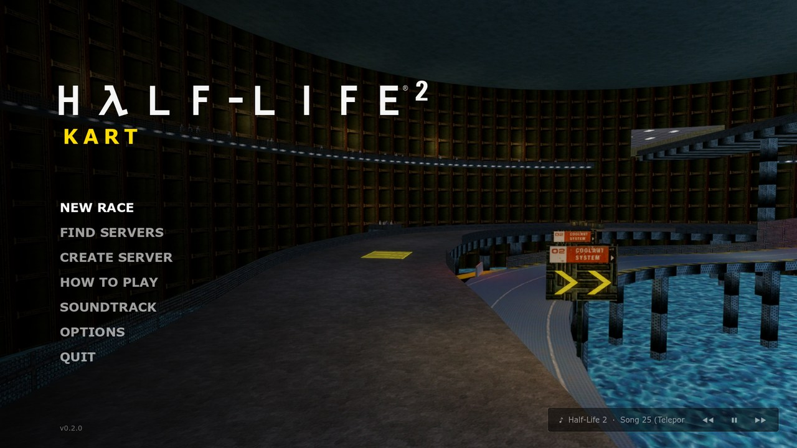</td>
    <td width="33%">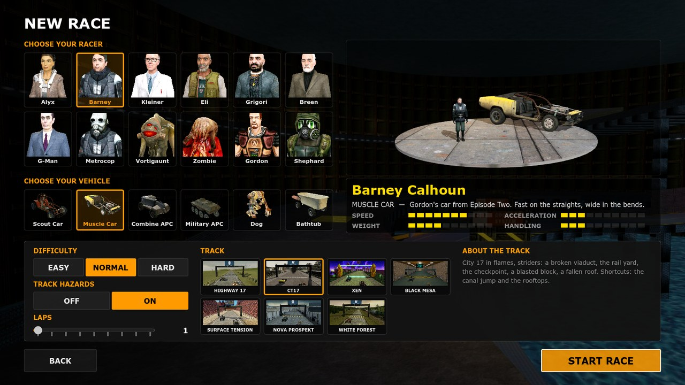</td>
    <td width="33%">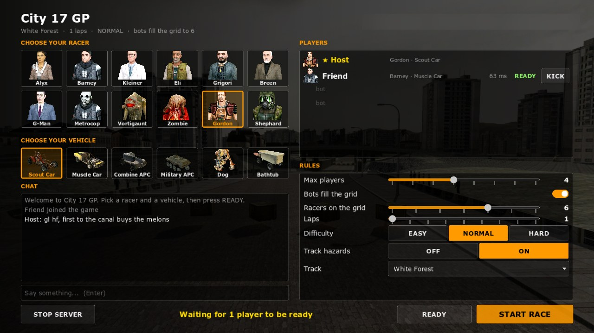</td>
  </tr>
  <tr>
    <td align="center">Главное меню</td>
    <td align="center">Новая гонка</td>
    <td align="center">Сетевое лобби</td>
  </tr>
</table>

<a id="play"></a>
## Как играть

1. Установите **Half-Life 2** и **Half-Life** в Steam (Windows 10 или 11).
2. Скачайте **HL2Kart-v…-windows.zip** из [последнего релиза](https://github.com/NVG-Games/hl2-kart/releases/latest)
   и распакуйте куда угодно.
3. Запустите **Play HL2 Kart.bat**.

При первом запуске игра находит обе игры и собирает из них всё нужное: от 3 до 6 минут и
около 2 ГБ. Дальше она сразу открывает меню. В архиве уже есть Godot и небольшой Python,
ставить ничего не нужно, и нет ничего от Valve: контент делается у вас на компьютере из
ваших копий. Когда выйдет новая версия, в главном меню появится кнопка скачать. Если
обновление меняет контент игры (новые трассы, зрители, ловушки), при первом запуске после
него контент собирается заново тем же способом.

Если Windows SmartScreen предупреждает о неизвестном приложении: *Подробнее* → *Выполнить в любом случае*.

### Из исходников

Для разработки или чтобы запустить свежий код из ветки `dev`:

- **Godot 4.7** (обычная сборка: бесплатный «Godot Engine» в Steam или
  [godotengine.org](https://godotengine.org)) и **Python 3.10+** с пакетами `numpy` и `Pillow`.

```bash
git clone https://github.com/NVG-Games/hl2-kart.git
cd hl2-kart
pip install numpy pillow
godot --path .
```

При первом запуске контент собирается так же (или через `python tools/setup_assets.py`;
`--only <шаг>` и `--from <шаг>` повторяют или продолжают шаг:
`extract, music, skies, tracks, import, ui`).

## Управление

| Действие | Клавиатура | Геймпад |
|---|---|---|
| Газ | W / ↑ | A, правый триггер |
| Тормоз / задний ход | S / ↓ | X, левый триггер |
| Руль | A / D, ← / → | левый стик, крестовина |
| Прыжок и дрифт | Shift / Пробел | RB |
| Предмет | E / Ctrl / Enter | LB, B |
| Чат (в сетевой игре) | Y / T | |
| Взгляд назад | C | Y |
| Позвать на помощь | R | Back |
| Пауза | Esc / P | Start |

Кнопки геймпада здесь названы как на Xbox. Подходит любой геймпад (Xbox, PlayStation, Nintendo
Switch, Steam Deck и другие), и игра показывает кнопки именно этого геймпада. Любое управление
можно переназначить в Options → Controls.

## Мультиплеер

Сеть устроена как у серверов Source: UDP 27015 для игры, 27016 для браузера серверов и
поиска в локальной сети, и по желанию мастер-сервер на UDP 27010 для вкладки INTERNET.

- **Свой сервер:** CREATE SERVER, имя, пароль, максимум игроков, боты, круги, сложность,
  ловушки и трасса. Хост тоже гоняет.
- **Подключение:** FIND SERVERS. В одной сети сервер появится во вкладке LAN, через
  интернет введите адрес хоста. Если у хоста роутер без UPnP, пробросьте UDP
  27015–27016 или играйте через виртуальную сеть (Radmin VPN, ZeroTier, Tailscale).
- **Одна версия на всех компьютерах:** эта сборка работает по сетевому протоколу 4.
  Сервер другой версии в FIND SERVERS помечен *(different version)* и не пустит вас,
  так что обновляйтесь вместе.
- **Лобби:** ник, гонщик и машина; хост меняет правила и запускает гонку. Ловушки (ON или
  OFF) выбирает хост, и это правило для всех (в строке лобби тогда видно «hazards off»);
  зрители у каждого свои, в его настройках.
- **Гонка:** старт, отсчёт и время гонки идут по часам сервера, поэтому время и итоги у
  всех совпадают. Сервер ждёт медленный компьютер до 45 с, потом стартует, а опоздавший
  подключается к уже идущей гонке. Если игрок вышел посреди гонки, его машину ведёт бот.

Выделенный сервер (без окна, консоль как у srcds; настройки можно положить в
`server.cfg`, образец в `server.cfg.example`):

```bash
godot --headless --path . -- --dedicated --name "City 17 GP" --max 8 --bots on --laps 3 --track xen
```

Трассы: `city17_circuit`, `ct17`, `black_mesa`, `xen`, `surface_tension`, `nova_prospekt`,
`white_forest`.
`--hazards off` (`mp_hazards 0` в `server.cfg`, `set mp_hazards 0` в консоли) убирает
ловушки с трассы.
Консоль: `status`, `say <текст>`, `kick <ник>`, `start`, `lobby`, `set <параметр> <значение>`, `rules`, `quit`.

Мастер-сервер для вкладки INTERNET, на любом компьютере с открытым UDP 27010:

```bash
godot --headless --path . -- --master-server --port 27010
```

## Как делиться игрой

- Делитесь ссылкой на [страницу релизов](https://github.com/NVG-Games/hl2-kart/releases).
  Каждый скачивает архив и при первом запуске собирает контент из своих Half-Life 2 и
  Half-Life, сервер тоже.
- Сам официальный архив можно передавать. **Не выкладывайте** папку игры после первого
  запуска, папку `assets/` или извлечённые файлы: этот контент принадлежит Valve.
- Форки, моды и новые трассы приветствуются на тех же некоммерческих условиях.

## Участие в разработке

Помощь приветствуется: код, новые трассы, тестирование, переводы, идеи. Прочитайте
[CONTRIBUTING.md](CONTRIBUTING.md), возьмите задачу с меткой `good first issue` или
откройте свою, чтобы обсудить идею. Работа идёт в ветке **`dev`** (она основная), а
**`main`** двигается только при выпуске версии; все версии описаны в [CHANGELOG.md](CHANGELOG.md).

## Разработчикам

- `scripts/`: игра на GDScript. `shaders/`: шейдеры в стиле Source.
- `tools/`: Python. Чтение VPK, MDL/VVD/VTX, GoldSrc MDL, VTF, VMT и WAD;
  `track_gen.py` строит трассы по описаниям в `tools/circuits/` (сплайн из участков
  разного типа: улица, открытая дорога, тоннель или зал, труба, мост, выемка, прыжок)
  вместе с рельефом, пропами, светом и вывесками (`build_track.py`, построитель прежней
  Highway 17, устарел). Скрипт берёт срезки из `branches.py`, ловушки из `hazards.py`,
  зрителей из `crowds.py`. `source_world.py` / `goldsrc_world.py` переводят целые карты HL2 / HL1,
  если хочется поэкспериментировать с настоящими уровнями.
- `tests/`: безоконные заезды AI со статистикой (`race_stats.tscn`), фототуры, проверка
  разметки меню (`ui_fit.tscn`), проверки срезок, ловушек и зрителей (`branch_check.tscn`,
  `hazard_test.tscn`, `crowd_check.tscn`), сетевые прогоны и проверка компиляции всех
  скриптов.

Новая трасса: один модуль Python в `tools/circuits/` и записи в `TRACKS` в
`scripts/core/game.gd` и в `CIRCUITS` в `tools/setup_assets.py` (подробнее в
[CONTRIBUTING.md](CONTRIBUTING.md)). `tools/package_release.py` собирает архив для Windows; workflow
*Release build* запускает его и готовит черновик релиза на GitHub, когда в `main` меняется
`version.json`.

## Лицензия

Код © NVG Games, лицензия [PolyForm Noncommercial 1.0.0](LICENSE.md): его можно
бесплатно использовать, менять и распространять в любых некоммерческих целях. Контент
Half-Life © Valve Corporation и в репозиторий не входит, см. [LEGAL.md](LEGAL.md).
