<p align="center">
  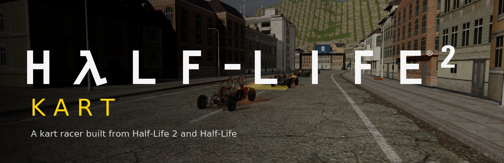
</p>

<p align="center">
  <b>Картинг в духе Mario Kart на Godot 4.7, собранный из ваших копий Half-Life 2 и Half-Life.</b><br>
  Пять больших трасс · 12 гонщиков · 6 машин · предметы из HL2 · дрифт и турбо · игра по сети и через интернет
</p>

<p align="center">
  
  
  
  
</p>

<p align="center"><a href="README.md">English version</a></p>

> **Бесплатный некоммерческий фанатский проект, не связанный с Valve.** В репозитории
> только код. Чтобы играть, нужны **Half-Life 2** и **Half-Life** в Steam: один скрипт
> собирает из них все модели, текстуры, звуки и трассы у вас на компьютере.
> Подробности в [LEGAL.md](LEGAL.md).

## Трассы

Каждый круг около 2 км, примерно минута. Дорогу, стены, тоннели и мосты строят
инструменты трасс, а оформляют их текстуры, модели, небо, вывески и музыка из самих игр.

<table>
  <tr>
    <td width="50%">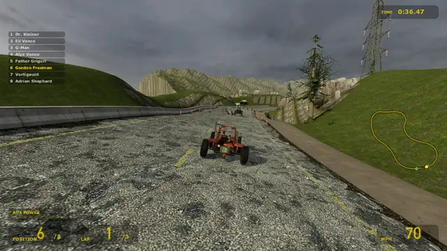</td>
    <td width="50%">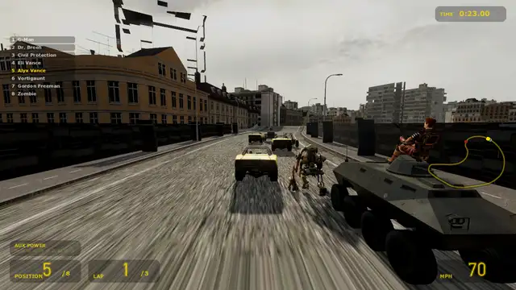</td>
  </tr>
  <tr>
    <td><b>Highway 17</b><br>Из City 17 через блокпост Альянса, по прибрежному шоссе с прыжком через залив и обратно по каналу. Погоду можно выбрать.</td>
    <td><b>CT17</b><br>City 17 под Альянсом: вокзальная площадь с трансляциями Брина, старый город, блокпост, прыжок через канал, сортировочная станция и тоннель.</td>
  </tr>
  <tr>
    <td>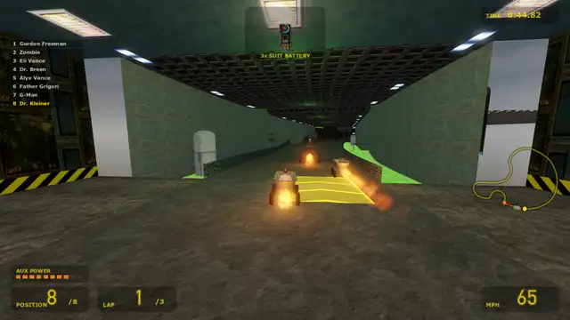</td>
    <td>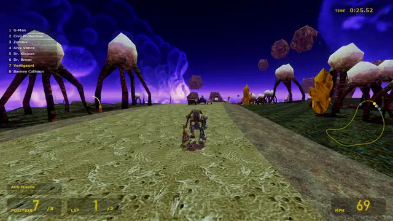</td>
  </tr>
  <tr>
    <td><b>Black Mesa</b><br>Внутри исследовательского комплекса: холл сектора C, лаборатории, тоннель монорельса, склад, переработка токсичных отходов с прыжком над кислотой и спираль вокруг реактора «Лямбда». Говорит диктор VOX.</td>
    <td><b>Xen</b><br>Парящие острова над пустотой: светящиеся стебли, кристаллы и грибы, два прыжка через пропасти, светящаяся пещера и Нихилант вдалеке.</td>
  </tr>
  <tr>
    <td>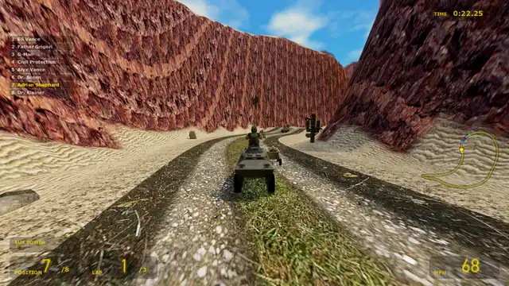</td>
    <td>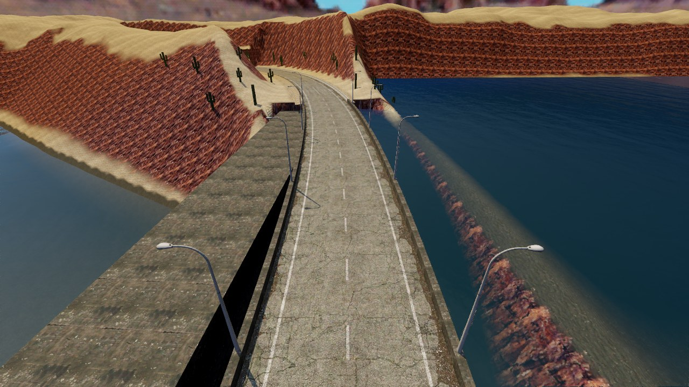</td>
  </tr>
  <tr>
    <td colspan="2"><b>Surface Tension</b><br>Пустыня у Чёрной Мезы: каньоны из красного камня и кактусы, размытая дорога с прыжком, стальной мост над ущельем реки, лагерь HECU с «Оспреем», старая шахта и гребень плотины.</td>
  </tr>
</table>

## Гонщики и машины

<p align="center">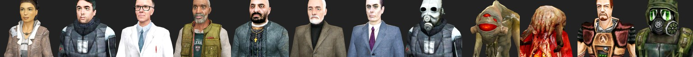</p>

Аликс, Барни, Кляйнер, Илай, отец Григорий, доктор Брин, G-Man, метрокоп, вортигонт и
зомби из Half-Life 2, а также Гордон Фримен и Адриан Шепард из Half-Life. Каждый
говорит своими репликами из игр.

<p align="center">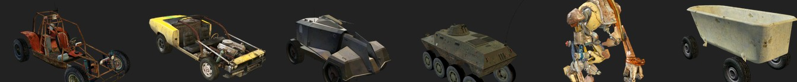</p>

Багги, маслкар Гордона из Episode Two, Combine APC, армейский БТР, Дог (несёт гонщика
на плечах) и ванна на колёсах. У каждой своя скорость, разгон, масса, управляемость и
звук мотора.

## Возможности

- **Предметы** из ящиков снабжения HL2: самонаводящийся мэнхек, роллермина, взрывная
  бочка, ускорение от батареи HEV, гравипушка, капсула хедкрабов по лидеру и щит от
  зарядника HEV.
- **Дрифт:** зажмите прыжок в повороте, дайте зарядиться шкале AUX POWER и отпустите
  для мини- или супер-турбо. Газ на счёт «one» даёт ракетный старт.
- **Спасение:** вылетели или застряли, и сканер Альянса вернёт вас на дорогу.
- **Мультиплеер:** LAN и интернет, браузер серверов как в Half-Life, лобби с чатом, боты
  на пустых местах, выделенный сервер и мастер-сервер.
- **Как в Source:** шейдеры в духе VertexLitGeneric / LightmappedGeneric, небо HL2 и HL1,
  `sv_gravity 600`, свойства машин и поверхностей из скриптов игры, музыка HL2 и HL1.

<table>
  <tr>
    <td width="33%">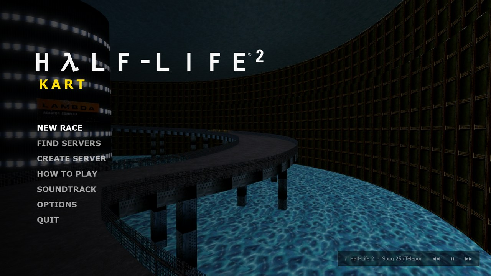</td>
    <td width="33%">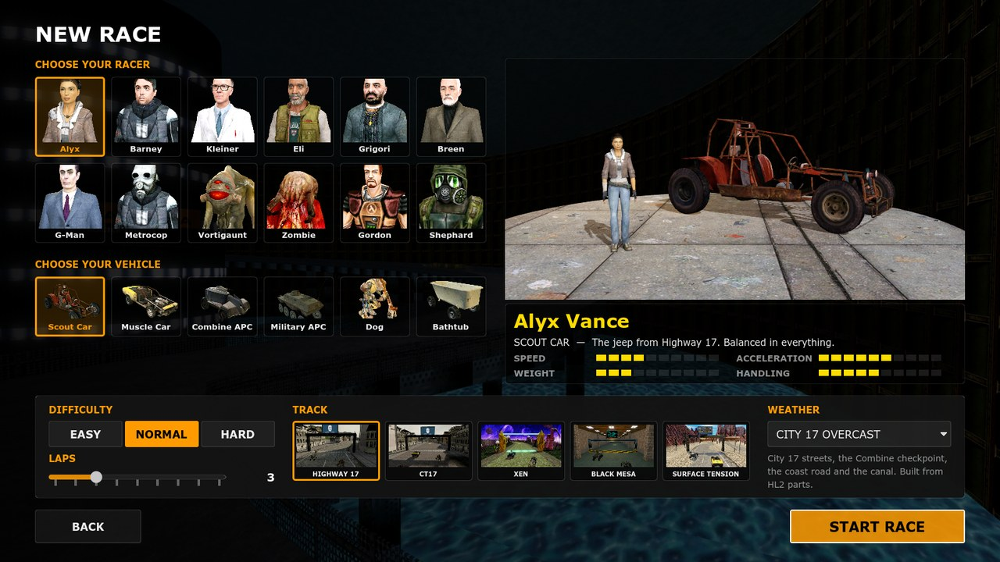</td>
    <td width="33%">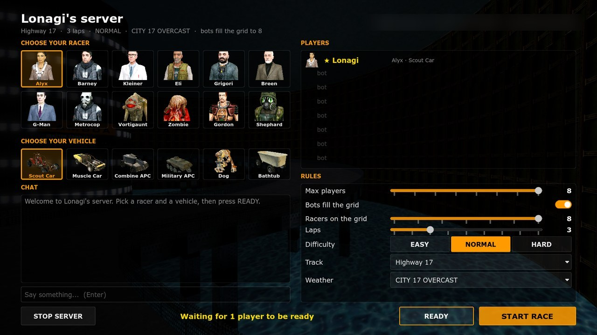</td>
  </tr>
  <tr>
    <td align="center">Главное меню</td>
    <td align="center">Новая гонка</td>
    <td align="center">Сетевое лобби</td>
  </tr>
</table>

## Как начать

Нужны:

- Windows 10 или 11 (инструменты понимают и пути Steam в Linux, но проверено только на Windows);
- **Half-Life 2** (в неё входят Episode One и Two) и **Half-Life** в Steam;
- **Godot 4.7**, обычная сборка (бесплатный «Godot Engine» в Steam или с
  [godotengine.org](https://godotengine.org));
- **Python 3.10+** с пакетами `numpy` и `Pillow`;
- около 2 ГБ свободного места.

```bash
git clone https://github.com/NVG-Games/hl2-kart.git
cd hl2-kart
pip install numpy pillow
python tools/setup_assets.py
```

Скрипт сам находит обе игры в библиотеках Steam, а Godot через `GODOT`, копию из Steam
или `godot` в `PATH` (иначе задайте `HL2_ROOT` / `HL1_ROOT` или передайте
`--godot <путь>`). Он извлекает контент игр, строит пять трасс, импортирует всё в Godot
и рисует картинки для меню; в конце Godot на несколько минут откроет окно. Отдельный шаг
можно повторить через `--only <шаг>` или продолжить через `--from <шаг>`
(`extract, music, skies, highway17, tracks, import, ui`).

Потом двойной клик по `Play HL2 Kart.bat` или `godot --path .`.

## Управление

| Действие | Клавиатура | Геймпад |
|---|---|---|
| Газ | W / ↑ | A, правый триггер |
| Тормоз / задний ход | S / ↓ | X, левый триггер |
| Руль | A / D, ← / → | левый стик |
| Прыжок и дрифт | Shift / Пробел | RB |
| Предмет | E / Ctrl / Enter | LB, B |
| Чат (в сетевой игре) | Y / T | |
| Взгляд назад | C | Y |
| Вызвать сканер | R | Back |
| Пауза | Esc / P | Start |

## Мультиплеер

Сеть устроена как у серверов Source: UDP 27015 для игры, 27016 для браузера серверов и
поиска в локальной сети, и по желанию мастер-сервер на UDP 27010 для вкладки INTERNET.

- **Свой сервер:** CREATE SERVER, имя, пароль, максимум игроков, боты, круги, сложность,
  трасса и погода. Хост тоже гоняет.
- **Подключение:** FIND SERVERS. В одной сети сервер появится во вкладке LAN, через
  интернет введите адрес хоста. Если у хоста роутер без UPnP, пробросьте UDP
  27015–27016 или играйте через виртуальную сеть (Radmin VPN, ZeroTier, Tailscale).
- **Лобби:** ник, гонщик и машина; хост меняет правила и запускает гонку. Если игрок
  вышел посреди гонки, его машину ведёт бот.

Выделенный сервер (без окна, консоль как у srcds; настройки можно положить в
`server.cfg`, образец в `server.cfg.example`):

```bash
godot --headless --path . -- --dedicated --name "City 17 GP" --max 8 --bots on --laps 3 --track xen
```

Трассы: `city17_circuit`, `ct17`, `black_mesa`, `xen`, `surface_tension`.
Консоль: `status`, `say <текст>`, `kick <ник>`, `start`, `lobby`, `set <параметр> <значение>`, `quit`.

Мастер-сервер для вкладки INTERNET, на любом компьютере с открытым UDP 27010:

```bash
godot --headless --path . -- --master-server --port 27010
```

## Как делиться игрой

- Делитесь ссылкой на репозиторий. Каждый клонирует его и запускает установку со своими
  Half-Life 2 и Half-Life, сервер тоже.
- **Не выкладывайте** папку `assets/`, извлечённые файлы или собранную игру никуда.
  Этот контент принадлежит Valve.
- Форки, моды и новые трассы приветствуются на тех же некоммерческих условиях.

## Разработчикам

- `scripts/`: игра на GDScript. `shaders/`: шейдеры в стиле Source.
- `tools/`: Python. Чтение VPK, MDL/VVD/VTX, GoldSrc MDL, VTF, VMT и WAD;
  `build_track.py` строит Highway 17, `track_gen.py` строит остальные трассы по
  описаниям в `tools/circuits/` (сплайн из участков разного типа: улица, открытая
  дорога, тоннель или зал, мост, выемка, прыжок) вместе с рельефом, пропами, светом и
  вывесками. `source_world.py` / `goldsrc_world.py` переводят целые карты HL2 / HL1, если
  хочется поэкспериментировать с настоящими уровнями.
- `tests/`: безоконные заезды AI со статистикой (`race_stats.tscn`), фототуры, проверка
  разметки меню (`ui_fit.tscn`), сетевые прогоны и проверка компиляции всех скриптов.

Новая трасса: один модуль Python в `tools/circuits/` и запись в `TRACKS` в
`scripts/core/game.gd`.

## Лицензия

Код © NVG Games, лицензия [PolyForm Noncommercial 1.0.0](LICENSE.md): его можно
бесплатно использовать, менять и распространять в любых некоммерческих целях. Контент
Half-Life © Valve Corporation и в репозиторий не входит, см. [LEGAL.md](LEGAL.md).
